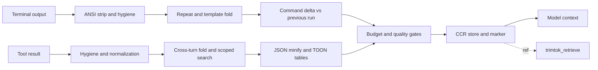

<h1 align="center">trimtok</h1>

<p align="center">
  <strong>Local, stdlib-only context compressor for Hermes Agent. 88.1% fewer characters across the full stress suite. Every byte recoverable.</strong>
</p>

<p align="center">
  <a href="#performance"></a>
  <a href="#performance"></a>
  <a href="#safety-rail-ccr"></a>
  <a href="#installation"></a>
  <a href="LICENSE"></a>
</p>

---

## Overview

trimtok is a local compression layer for Hermes Agent. Terminal output and tool results pass through a staged pipeline before they reach the model: repeated lines collapse to `[repeated Nx]`, scattered same-shape lines to template folds, near-duplicates to shingle pointers, uniform JSON arrays to lossless TOON tables, and a repeated command to a cross-turn delta of added, removed and still-failing lines. The full original of every compressed result is stored in a local content-addressed cache and restores with one `trimtok_retrieve` call.

A repeated test command compresses to this (real output, prior run in the same session):

```
[tt:delta cmd="pytest -q" sim=100% +#1 -#1 !#1 #c2 #c1]
--- STILL FAILING / ACTIVE ERRORS (1) ---
! FAILED test_1000.py::test_boom - AssertionError: expected 1 got 2
--- ADDED / CHANGED IN THIS TURN (+1) ---
+ ===== 1 failed, 200 passed in 43.2s =====
--- RESOLVED / REMOVED (-1) ---
- ===== 1 failed, 200 passed in 42.1s =====
```

Measured results (`python tests/stress_heavy.py`; full tables in `tests/STRESS_REPORT.md` and `tests/BASELINE_*.md`):

| Workload | Before → After | Cut |
| :--- | :--- | ---: |
| 1 MB repeated tool output | 1,000,000 → 159 chars | 100.0% |
| 500 KB repeated log | 500,000 → 250 chars | 100.0% |
| 5k-line heartbeat log | 234,999 → 224 chars | 99.9% |
| Cross-turn pytest loop (5 runs) | 210,725 → 3,136 chars | 98.5% |
| 3k-line error log | 141,779 → 9,214 chars | 93.5% |
| 4.8k-line traceback | 94,656 → 11,230 chars | 88.1% |
| Realistic 5-turn mixed session | 105,839 → 39,904 chars | 62.3% |
| **All 34 stress cases** | **3,559,894 → 422,408 chars** | **88.1%** |

<p align="center">
  
</p>

## Why trimtok

- **Fewer tokens per turn.** Heavy outputs keep their information density; whole logs stop flooding the context window.
- **Nothing is lost.** Every fold stores the original locally. Fault lines (errors, exceptions, HTTP 5xx) never fold, in English or Thai, and a failure that persists across turns stays visible under `STILL FAILING`.
- **No dependencies, no network.** Pure Python standard library. Nothing leaves the machine.
- **Fail-open always.** If compression errors or exceeds its 50 ms guard budget, the original text passes through untouched.

## Feature comparison

Against plain forwarding (no compression layer):

| Dimension | Without trimtok | With trimtok |
| :--- | :--- | :--- |
| 5k-line repeated log | 234,999 chars reach the model | 224 chars plus a retrievable ref |
| Second run of the same command | full output again | delta of added, removed, still failing (98.5% smaller over a 5-turn loop) |
| 1,000-row JSON array | raw JSON | lossless TOON table (74.3% smaller on the 1k-row case) |
| A failing test line | scrolls away in bulk output | kept verbatim by fault rails, always |
| Restoring an original | not available | one `trimtok_retrieve` call, paginated and grep-filtered |

## Dataflow



Decision rules in plain language:

- Outputs under 2 KB (`min_chars`) pass through untouched.
- A fold applies only when the result is verifiably smaller; TOON folds only when the table is byte-exact after a type-strict round-trip decode with at least 4 BPE tokens of net gain.
- Fault lines (error, exception, failure, HTTP 5xx, Thai failure words) are never folded, at any stage.
- Repeated commands in one session compare against the previous run; persistent failures are always re-emitted.
- Every compressed result stores its full original in the local CCR store, addressed by a short `#ref` alias or 12-char digest.
- Any error or guard timeout returns the original text (fail-open).

## Key modules

| Module | Role | Notes |
| :--- | :--- | :--- |
| `core.py` | Terminal pipeline | ANSI strip, repeat and template fold, budgets, never-inflate revert |
| `delta_engine.py` | Cross-turn command delta | similarity gate at 0.65, STILL FAILING rail, bounded per-session state |
| `dedup.py` | Tool-result pipeline | cross-turn fold, shingle dedup, HEAD_TAIL stubs, TOON wire |
| `scoped_search.py` | Multi-file search grouping | groups grep hits per file with definition headers |
| `toon_codec.py` | JSON to TOON tables | lossless round-trip gate, token-gain gate |
| `polarity.py` | Fault rails | English, Thai, HTTP 5xx; memoized classification |
| `marker.py` | Marker format | `[tt:...]` markers, legends, sentinel gate |
| `ccr_v2.py` | Content store | SQLite index, short `#ref` aliases, LRU and TTL eviction |
| `guard.py` | Fail-open deadline | hooks revert to the original past `guard_ms` |
| `__init__.py` | Hook adapter | 5 hooks, `trimtok_retrieve` tool, `/trimtok` commands |

## Safety rail: CCR

Every folded output is stored by content: a SQLite index plus local files under `plugin-data/trimtok/`, addressed by a short alias (`#c1`) or the 12-char SHA-256 digest. Retrieval is exact and paginated:

```json
{
  "name": "trimtok_retrieve",
  "arguments": {
    "hash": "#c1",
    "offset": 1,
    "limit": 50,
    "grep": "error|fail"
  }
}
```

Filters support regex up to 256 chars (no groups), input up to 1 MB, output capped at 1,000 matches or 100 KB. The store caps at 1,000 entries / 50 MB / 24 h TTL by default.

## Performance

Median overhead per path, n=50 (`python tests/test_benchmark.py`), with regression budgets:

| Measurement path | Scenario | Median (measured) | Budget |
| :--- | :--- | ---: | ---: |
| `compress_terminal` | Same 4.4 KB repeated build log | 0.96 ms | < 10 ms |
| Tool result: first-seen | Pretty JSON, fresh session | 9.3 ms | < 25 ms |
| Tool result: exact repeat | Repeat passthrough path | 0.08 ms | < 10 ms |
| Tool result: cross-turn fold | New result folds against a prior turn | 3.6 ms | < 10 ms |
| Tool result: no gain | Unique 9.5 KB input returns unchanged | 8.5 ms | < 10 ms |
| Command delta step | 200-line pytest pair | 0.61 ms | informational |
| CCR put / get | Unique payload put, warm alias get | 2.8 ms / 0.2 ms | < 5 ms |

The first-seen tool path budgets above its neighbors because it includes a full lossless round-trip verify. Cross-turn deltas on very large outputs (2,000+ lines) add roughly 5 ms in steady state, dominated by snapshot storage so that both refs stay retrievable.

## Configuration

Settings live under `plugins.entries.trimtok.settings` in the Hermes `config.yaml`:

| Parameter | Type | Default | Description |
| :--- | :--- | :--- | :--- |
| `enabled` | bool | true | Master switch for all hooks (fail-open when false). |
| `guard_ms` | float | 50 | Fail-open deadline budget in ms (1 to 1000). |
| `phase2_enabled` | bool | true | Tool-result pipeline switch (cross-turn fold). |
| `toon_enabled` | bool | true | Lossless JSON to TOON tables (round-trip verified). |
| `delta_enabled` | bool | true | Cross-turn command delta (STILL FAILING / added / removed). |
| `delta_threshold` | float | 0.65 | Similarity gate for command deltas; raise to 0.80 if retrieves grow unusual. |
| `min_chars` | int | 2048 | Minimum output size before compression. |
| `max_lines` | int | 120 | Terminal line-window budget. |
| `exclude_commands` | list | [] | Command prefixes that bypass terminal compression. |
| `exclude_tools` | list | [] | Hermes tool names that bypass tool-result compression. |
| `mask_enabled` / `mask_keep_turns` | bool / int | true / 2 | Fold-index freshness mask. |
| `audit_enabled` / `usage_enabled` | bool | true | Local savings and usage logs (1 MB rotation). |
| `ccr_max_entries` | int | 1000 | Cache entry cap (LRU). |
| `ccr_max_bytes` | int | 52428800 | Cache byte budget (50 MB). |
| `ccr_ttl_hours` | int | 24 | Original retention window. |

State bounds per session: fold index 200 spans / 2 MiB / 20k line keys; delta engine 32 commands / 24,000 lines / 1.5 MB.

## Slash commands

- `/trimtok status` - savings and cache entries (cleans expired).
- `/trimtok usage` - gate and shape breakdown, top-saving commands, retrieve hit rate.
- `/trimtok purge` - evict all cached originals.
- `/trimtok retrieve <hash>` - print a cached original.

## Installation

| Platform | Command |
| :--- | :--- |
| Windows (PowerShell) | `git clone https://github.com/Stxyu-p/trimtok.git "$env:LOCALAPPDATA\hermes\plugins\trimtok"` |
| Linux / macOS | `git clone https://github.com/Stxyu-p/trimtok.git ~/.hermes/plugins/trimtok` |

Then enable the plugin:

```bash
hermes plugins enable trimtok
```

Quick start:

1. Clone the repository into the Hermes plugins directory (table above).
2. Run `hermes plugins enable trimtok`.
3. Use Hermes as usual. Heavy outputs compress on their way to the model.
4. Need the full text back? Call `trimtok_retrieve` with the `#ref` from the marker, or use `/trimtok retrieve <ref>`.

## What is new

**0.10.0** adds the cross-turn command delta engine (STILL FAILING / added / removed views), memoized fault classification, and guaranteed store-alias refs in the packaged plugin. Full history: [CHANGELOG.md](CHANGELOG.md).

## Evidence and limitations

- All numbers were measured with the bundled harnesses (`tests/stress_heavy.py`, `tests/test_benchmark.py`) on synthetic fixtures: Python 3.14, Windows. Medians from 50 samples; relative behavior on other machines can differ by a constant factor.
- Refused or non-beneficial folds are byte-identical to their input; nothing is partially transformed.
- Stored originals stay on the local disk (`plugin-data/trimtok/`), expire after 24 h, and are capped at 50 MB.
- Cross-turn deltas on 2,000-line outputs add roughly 5 ms in steady state. The 200-line class measures 0.61 ms.
- Fail-open: any hook error or a `guard_ms` timeout returns the original text.

## Project structure

| Path | Contents |
| :--- | :--- |
| `core.py`, `dedup.py` | Terminal and tool-result compression pipelines |
| `delta_engine.py`, `toon_codec.py`, `scoped_search.py`, `bpe_estimator.py` | Cross-turn delta, TOON codec, search grouping, token estimator |
| `polarity.py`, `marker.py`, `guard.py` | Fault rails, marker format, deadline guard |
| `ccr.py`, `ccr_v2.py` | Retrieval store (legacy facade and v2 SQLite alias store) |
| `tests/` | Suites, stress harness, benchmarks, historical baselines |
| `docs/` | Architecture SVG and self-hosted badges |

## Verification

```bash
python tests/test_core.py
python tests/test_dedup.py
python tests/test_v2_phase4.py
python tests/stress_heavy.py
python tests/test_benchmark.py
```

Status: every push passes the full local suite and the isolated Hermes runtime integration test before it lands.

## License

MIT License. Designed and maintained by P Choke & MIKA.
