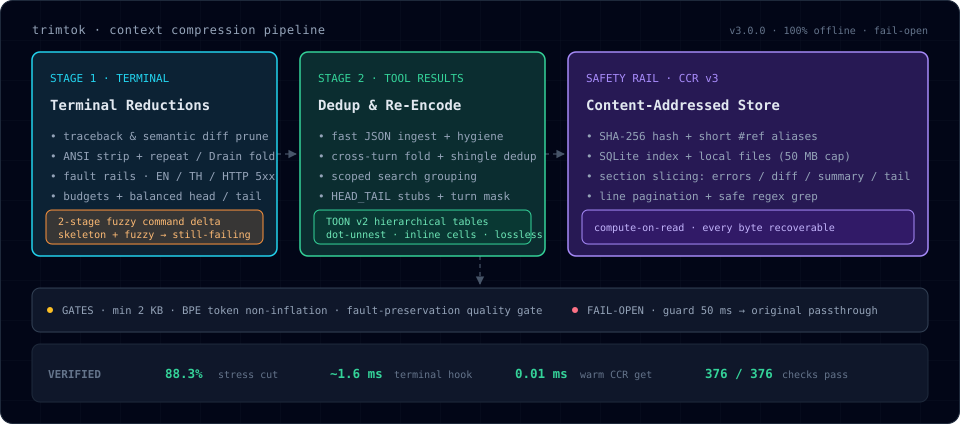

<h1 align="center">trimtok</h1>

<p align="center">
  <strong>Universal, local, deterministic context compressor for AI Agent CLIs & IDEs.<br/>88.3% fewer characters across stress benchmarks — zero intelligence lost, every byte recoverable.</strong>
</p>

<p align="center">
  <a href="#performance"></a>
  <a href="#system-footprint"></a>
  <a href="#safety-rail-ccr-v3"></a>
  <a href="#installation"></a>
  <a href="LICENSE"></a>
</p>

<p align="center">
  <a href="#overview">Overview</a> ·
  <a href="#how-it-works">How It Works</a> ·
  <a href="#architecture--modules">Modules</a> ·
  <a href="#safety-rail-ccr-v3">CCR v3 Retrieval</a> ·
  <a href="#performance">Performance</a> ·
  <a href="#configuration">Configuration</a> ·
  <a href="#installation">Installation</a> ·
  <a href="CHANGELOG.md">Changelog</a>
</p>

---

## Overview

**trimtok** compresses noisy terminal outputs and bulky tool results before they enter the model's context window. It operates 100% locally and offline with strict fail-open guarantees:

- **Terminal Pipeline (`Stage 1`):** Strips ANSI control sequences, prunes intermediate framework stack frames (`site-packages`, `node_modules`), collapses unchanged git diff context while preserving file and `@@` hunk scopes, folds exact and Drain-template repeats, and collapses repeated test/build commands into a cross-turn delta.
- **Tool Result Pipeline (`Stage 2`):** Deduplicates repeated spans across turns, groups multi-file grep hits under file and definition headers, and transcodes uniform or nested JSON arrays into lossless **TOON v2** columnar tables verified by an in-memory round-trip check and a BPE Token-Gain Gate.
- **Content-Addressed Recovery (`CCR v3`):** Every compressed output stores its exact, uncompressed original in a local two-tier SQLite + file store, addressable by a short `#ref` alias (e.g., `#c1`) with focused read-time section slicing (`errors`, `diff`, `summary`, `tail`), pagination, and safe regex grep.

<p align="center">
  
</p>

### Live Compression Examples

#### 1. Two-Stage Fuzzy Command Delta (`delta_engine.py`)
Running `pytest` a second time in the same session (even with shifted line numbers, updated durations, or cosmetic flag changes like `pytest -v` vs `pytest -q`):

```text
[tt:delta cmd="pytest -q" sim=99% +#1 -#1 !#1 #c2 #c1]
[tt:legend] Delta vs previous run of the same command: + added, - resolved/removed, ! still failing; refs = full snapshots via trimtok_retrieve.
--- STILL FAILING / ACTIVE ERRORS (1) ---
! FAILED test_1000.py::test_boom - AssertionError: expected 1 got 2
--- ADDED / CHANGED IN THIS TURN (+1) ---
+ ===== 1 failed, 200 passed in 43.2s =====
--- RESOLVED / REMOVED (-1) ---
- ===== 1 failed, 200 passed in 42.1s =====
```

#### 2. Lossless Hierarchical TOON v2 Table (`toon_codec.py`)
Nested JSON tool payloads (such as `search_web` or structured API responses) unnest via dot-notation with shared path prefixes and compact inline JSON cells:

```text
[tt:legend] TOON table (lossless): "@prefix(A)=base" = shared path shorthand; "@rows[N]{f1,f2}:" header, then N rows, cells split by "|" (quoted = literal).
@prefix(~/)=https://example.com/items/
@meta:{"status":"success"}
@data.results[3]{id,title,url,tags}:
0|Item 0|~/0|["dev","lead"]
1|Item 1|~/1|["qa"]
2|Item 2|~/2|["pm","ops"]
```

#### 3. Structured Traceback Pruning (`traceback_pruner.py`)
Collapses middle runs of external framework frames while preserving 100% of the entrypoint, all user project frames, the crash site frame, and the exception line:

```text
Traceback (most recent call last):
  File "/app/main.py", line 25, in handle_request
    result = pipeline.process(data)
  [... 3 framework frames omitted ...]
  File "/app/pipeline.py", line 58, in process
    return 100 / count
ZeroDivisionError: division by zero
```

---

### Measured Compression Results

Verified across the bundled 34-case heavy stress suite (`python tests/stress_heavy.py`):

| Workload Scenario | Before → After | Reduction |
| :--- | :--- | ---: |
| 1 MB repeated tool output (`D12`) | `1,000,000 → 159 chars` | **100.0%** |
| 500 KB repeated terminal log (`T14`) | `500,000 → 250 chars` | **100.0%** |
| 5,000-line heartbeat log (`T1`) | `234,999 → 224 chars` | **99.9%** |
| 2,000-line `pytest` output + 1 failure (`T2`) | `56,108 → 312 chars` | **99.4%** |
| 5-turn repeated `pytest` loop with Delta (`D16`) | `210,725 → 3,136 chars` | **98.5%** |
| Cross-turn search vs prior `read_file` (`D5b`) | `47,500 → 1,070 chars` | **97.7%** |
| 2,000-line Thai + English mixed log (`T11`) | `58,422 → 1,734 chars` | **97.0%** |
| Scoped multi-file grep search (`D14`) | `42,783 → 1,639 chars` | **96.2%** |
| 800-file `git diff` output (`T4`) | `46,760 → 2,110 chars` | **95.5%** |
| 3,000-line error-dense log (`T9`) | `141,779 → 9,214 chars` | **93.5%** |
| 4,800-line deep stack traceback (`T12`) | `94,656 → 11,230 chars` | **88.1%** |
| 1,000-row JSON array via TOON v2 (`D15b`) | `101,885 → 26,147 chars` | **74.3%** |
| Realistic 5-turn mixed session (`SIM`) | `105,839 → 39,904 chars` | **62.3%** |
| **All 34 stress cases combined** | **`3,559,894 → 417,581 chars`** | **88.3%** (~785k tokens saved) |

---

## How It Works

### Core Engineering Guarantees

| Guarantee | Mechanism |
| :--- | :--- |
| **Zero Intelligence Loss** | Error, exception, traceback crash site, HTTP 5xx, and Thai failure lines (`polarity.py`) are locked by fault rails and never folded or dropped. |
| **BPE Non-Inflation Gate** | Every fold is verified by `estimate_bpe_tokens()`. If a compressed output does not strictly reduce both character length and token count, it reverts to the original input. |
| **Lossless TOON Round-Trip** | `toon_codec.py` decodes every generated table back to Python objects and verifies recursive type-strict equality (`_strict_eq`) before emitting. |
| **100% Offline & Local** | Zero network sockets, zero external HTTP requests, and zero background daemons. All state lives in memory or local SQLite/files. |
| **Fail-Open Deadline Guard** | Any unhandled exception or execution exceeding `guard_ms` (default `50 ms`) immediately returns the untouched original string. |
| **Graceful Stdlib Fallback** | Runs out-of-the-box on pure Python standard library; automatically accelerates with `tiktoken`, `jiter`, and `rapidfuzz` when present in the environment. |

### Pipeline Decision Rules

| Input Class | Pipeline Behavior |
| :--- | :--- |
| **Small outputs (`< 2 KB`)** | Bypass compression untouched (`passthrough_small`). |
| **Verbatim reference tools** | `read_file` is indexed into the session corpus for future cross-turn folds, but its own output is returned verbatim (`passthrough_reference`) so file edits never operate on stubs. |
| **Repeated terminal commands** | Compared against the previous run in the same session and command family; emits a compact `[tt:delta]` view when similarity $\ge 0.65$. |
| **Multi-file search results** | Grouped by file path and enclosing function/class definition header via `scoped_search.py`. |
| **Cross-turn staleness** | `post_llm_call` ages out fold pointers older than `mask_keep_turns` (default `2` turns) so the model never references stale context. |

---

## Architecture & Modules

| File | Role | Key Responsibilities |
| :--- | :--- | :--- |
| `core.py` | **Stage 1: Terminal Pipeline** | Kind detection, traceback/diff pruning, ANSI/spinner stripping, exact & Drain template folding, command budgets, BPE non-inflation gate, fault quality gate. |
| `dedup.py` | **Stage 2: Tool Result Pipeline** | Hygiene & volatile normalization, JSON minification, cross-turn span/line folding, 3-gram shingle near-dedup, `HEAD_TAIL` windowing, TOON v2 transcoding. |
| `bpe_estimator.py` | **Token & JSON Accelerator** | Offline `tiktoken` singleton with 64 KB sampling, Rust `jiter` `fast_json_loads()`, and regex/stdlib fallbacks. |
| `toon_codec.py` | **Lossless TOON v2 Codec** | Multi-level dot-notation wrapper unnesting, shared path `@prefix`, inline compact JSON cells (`<= 120 chars`), in-memory `_strict_eq()` verification. |
| `delta_engine.py` | **Cross-Turn Command Delta** | Safe command family normalization, 2-stage line alignment ($O(N)$ skeleton + `rapidfuzz`), `STILL FAILING` canary rail, bounded per-session LRU state. |
| `traceback_pruner.py` | **Stack Trace Compressor** | Collapses intermediate framework frames (`site-packages`, `node_modules`, etc.) for Python and Node/JS while keeping entrypoints, user frames, and exceptions. |
| `diff_engine.py` | **Semantic Diff Compressor** | Preserves `diff --git`, `---`/`+++`, `@@` hunk headers with function scope, and `+`/`-` edits; collapses $> 6$ unchanged context lines. |
| `scoped_search.py` | **Search Hit Grouping** | Groups `grep` / `search_files` results by file and enclosing `def`/`class`/`func` scope. |
| `polarity.py` | **Canary Fault Rails** | Memoized (`@lru_cache`) fault detector covering English, Thai, compiler/test failures, and HTTP 5xx status lines; honours negative-polarity masks (`0 errors`). |
| `marker.py` | **Marker & Legend Grammar** | Canonical `[tt:...]` headers, pointer stubs (`[@#c1 xN]`), sentinel regexes, and unified token estimator routing. |
| `ccr_v2.py` / `ccr.py` | **Two-Tier CCR Store** | SQLite content-addressed index issuing short monotonic `#cN` aliases backed by local files, with LRU byte/entry caps and TTL eviction. |
| `guard.py` | **Fail-Open Budget Guard** | Monotonic `Deadline` timer (`guard_ms`) and verbatim tool registry (`VERBATIM_TOOLS`). |
| `__init__.py` | **Hermes Plugin Adapter** | Registers 5 lifecycle hooks, the `trimtok_retrieve` tool (with v3 section slicing), `/trimtok` slash commands, and rotating `audit.jsonl` / `usage.jsonl` logs. |
| `plugin.yaml` | **Plugin Manifest** | Hermes plugin metadata, hook/tool declarations, and configuration schema. |

---

## Safety Rail: CCR v3

Every compressed terminal output or tool result stores its full, unmodified original in the Content-Addressed Context Recovery (**CCR v3**) store.

### Store Properties

| Property | Specification |
| :--- | :--- |
| **Reference Format** | Short monotonic alias (`#c1`, `#c2`, ...) or legacy 12-char SHA-256 hex digest |
| **Storage Backend** | Two-tier SQLite metadata/alias index + raw UTF-8 files under `~/.hermes/plugin-data/trimtok/` |
| **Default Retention & Caps** | Max `1,000` entries, `50 MB` total size, `24 hours` TTL with automatic LRU eviction |
| **Safety Limits** | Grep regex capped at `256` chars (safe subset, no catastrophic backtracking), `1 MB` input, `1,000` matches / `100 KB` output |

### `trimtok_retrieve` Modes

| Mode | Parameters | Behavior |
| :--- | :--- | :--- |
| **Section: Errors** | `{"hash": "#c1", "section": "errors", "context_lines": 3}` | Scans original via `is_important()`, merges overlapping `±context_lines` windows, and returns `line_no\|text` chunks. |
| **Section: Diff** | `{"hash": "#c1", "section": "diff", "context_lines": 3}` | Extracts unified diff file headers, `@@` hunk headers, and `+`/`-` changes with surrounding context. |
| **Section: Summary** | `{"hash": "#c1", "section": "summary"}` | Returns total line/char counts, error line count, first 15 lines, last 25 lines, and top 20 error lines. |
| **Section: Tail** | `{"hash": "#c1", "section": "tail", "limit": 50}` | Returns the last `limit` lines (default `50`, max `1,000`) with 1-indexed line numbers. |
| **Regex Grep** | `{"hash": "#c1", "grep": "ConnectionRefused\|503"}` | Case-insensitive safe regex search across the stored original with `line_no\|text` output. |
| **Line Pagination** | `{"hash": "#c1", "offset": 100, "limit": 80}` | Slices lines `100..179` (`1-indexed`) with line numbers. |
| **Full Restore** | `{"hash": "#c1"}` | Returns the complete uncompressed `original_content`. |

#### Example Tool Call (Focused Error Retrieval)

```json
{
  "name": "trimtok_retrieve",
  "arguments": {
    "hash": "#c1",
    "section": "errors",
    "context_lines": 2
  }
}
```

---

## Performance

Measured on Windows (Python 3.14, $n = 50$ iterations per benchmark via `python tests/test_benchmark.py` and `python tests/test_v3_upgrade.py`):

| Execution Path | Workload Scenario | Measured Median | P95 | Regression Budget |
| :--- | :--- | ---: | ---: | ---: |
| `compress_terminal` | 4.4 KB repeated build log | **1.62 ms** | 3.53 ms | `< 10.0 ms` |
| `compress_tool_result` (first-seen) | Pretty JSON + TOON v2 round-trip verify | **10.29 ms** | 15.10 ms | `< 25.0 ms` |
| `compress_tool_result` (repeat) | Exact-repeat passthrough | **0.08 ms** | 0.20 ms | `< 10.0 ms` |
| `compress_tool_result` (cross-turn) | 60 shared lines folded against session index | **2.65 ms** | 5.52 ms | `< 10.0 ms` |
| `compress_tool_result` (no-gain) | ~9.5 KB unique input (reverts cleanly) | **3.95 ms** | 8.15 ms | `< 10.0 ms` |
| `fast_json_loads` | 1,000 JSON objects (~100 KB) | **0.70 ms** | — | `< 15.0 ms` |
| `estimate_bpe_tokens` | ~96 KB text (with 64 KB fast sampling) | **0.66 ms** | — | `< 20.0 ms` |
| `try_delta` (2-stage fuzzy) | 200-line command output with shifted lines | **1.35 ms** | — | `< 5.0 ms` |
| `ccr_v2.put` / `ccr_v2.get` | Unique payload write / warm `#ref` alias read | **0.22 ms / 0.011 ms** | 0.42 ms / 0.012 ms | `< 5.0 ms` |

### System Footprint & Memory Bounds

| Resource | Bound |
| :--- | :--- |
| **Runtime Dependencies** | Zero required (100% stdlib fallback); auto-uses `tiktoken`, `jiter`, `rapidfuzz` when installed |
| **Network Activity** | Zero listening ports, zero outbound sockets (100% offline) |
| **Session Dedup Index** | Capped at `200` spans, `2 MiB` text, and `20,000` line keys per session (FIFO eviction) |
| **Session Delta State** | Capped at `32` command families, `24,000` total lines (`6,000` per command), `1.5 MB` per session |
| **CCR Disk Store** | Capped at `1,000` entries, `50 MB`, `24 h` TTL |
| **Telemetry Logs** | `audit.jsonl` and `usage.jsonl` capped at `1 MB` each with `.1` single-file rotation |

---

## Configuration

Configure under `plugins.entries.trimtok.settings` in your Hermes `config.yaml`:

| Setting | Type | Default | Description |
| :--- | :---: | :---: | :--- |
| `enabled` | `bool` | `true` | Master switch for all hooks (`false` = passthrough). |
| `guard_ms` | `float` | `50` | Fail-open deadline budget in milliseconds (`1–1000`; strict profile: `8.5`). |
| `min_chars` | `int` | `2048` | Minimum character length before compression runs. |
| `max_lines` | `int` | `120` | Default terminal line-window budget when no command-specific budget applies. |
| `phase2_enabled` | `bool` | `true` | Enables `transform_tool_result` cross-turn deduplication. |
| `toon_enabled` | `bool` | `true` | Enables lossless JSON-to-TOON v2 columnar table transcoding. |
| `delta_enabled` | `bool` | `true` | Enables cross-turn stateful command delta compression. |
| `delta_threshold` | `float` | `0.65` | Minimum line/skeleton overlap ratio (`0.5–1.0`) required to emit a command delta. |
| `exclude_commands` | `list[str]` | `[]` | Command prefixes (e.g., `["git log", "docker inspect"]`) that bypass terminal compression. |
| `exclude_tools` | `list[str]` | `[]` | Tool names that bypass tool-result compression. |
| `mask_enabled` | `bool` | `true` | Enables `post_llm_call` freshness masking of old turn pointers. |
| `mask_keep_turns` | `int` | `2` | Number of recent turns kept active before fold pointers expire (`0–32`). |
| `audit_enabled` | `bool` | `true` | Writes per-transform savings records to `audit.jsonl`. |
| `usage_enabled` | `bool` | `true` | Writes hook and retrieval telemetry to `usage.jsonl` for `/trimtok usage`. |
| `ccr_max_entries` | `int` | `1000` | Maximum cached originals in CCR before LRU eviction (`10–100000`). |
| `ccr_max_bytes` | `int` | `52428800` | Maximum total disk budget in bytes (`50 MB` default). |
| `ccr_ttl_hours` | `int` | `24` | Retention TTL in hours for cached originals (`1–720`). |

### Slash Commands

| Command | Description |
| :--- | :--- |
| `/trimtok` or `/trimtok status` | Displays total transforms logged, characters saved, and current CCR cache entry/KB stats. |
| `/trimtok stats` | Alias for `/trimtok status`. |
| `/trimtok usage` | Aggregates `usage.jsonl` into gate/shape breakdowns, top-saving commands, and CCR retrieve hit rates. |
| `/trimtok purge` | Purges all cached original files and resets the CCR store. |
| `/trimtok retrieve <hash> [section]` | Retrieves a cached original by `#ref` or hash, optionally sliced by section (`errors`, `diff`, `summary`, `tail`). |

---

## Installation

### 1. Universal One-Command Auto-Install (Recommended)

Install `trimtok` and automatically register it into every supported AI agent CLI and IDE on your system with zero manual configuration:

```bash
pip install trimtok
trimtok install
```

`trimtok install` detects and atomically registers MCP tools into:
- **Claude Code** (`~/.claude.json` via official `claude mcp add-json`)
- **Claude Desktop** (`claude_desktop_config.json` on Windows, macOS, and Linux)
- **Gemini CLI** (`~/.gemini/settings.json`)
- **Google Antigravity & IDE** (`~/.gemini/config/mcp_config.json`, `~/.gemini/antigravity/mcp_config.json`)
- **Codex CLI** (`~/.codex/config.toml` with atomic TOML validation)
- **OpenCode** (`~/.config/opencode/opencode.json`)
- **VS Code / GitHub Copilot** (`mcp.json` user settings)
- **Cursor** (`~/.cursor/mcp.json`)
- **Windsurf** (`~/.codeium/windsurf/mcp_config.json`)
- **Cline** (`cline_mcp_settings.json`)

All configuration edits create an automatic pre-install backup (`.pre-mcp-install.bak`) and fail-open gracefully without interrupting running sessions.

#### Inspect Detected Clients

Verify registration status across all detected agent harnesses:

```bash
trimtok clients
```

Output:
```text
  claude-code      Claude Code        registered      ~/.claude.json
  claude-desktop   Claude Desktop     registered      AppData/Roaming/Claude/claude_desktop_config.json
  gemini-cli       Gemini CLI         registered      ~/.gemini/settings.json
  antigravity      Antigravity        registered      ~/.gemini/config/mcp_config.json
  antigravity-ide  Antigravity IDE    registered      ~/.gemini/antigravity/mcp_config.json
  codex            Codex CLI          registered      ~/.codex/config.toml
  opencode         OpenCode           registered      ~/.config/opencode/opencode.json
  vscode           VS Code (Copilot)  registered      AppData/Roaming/Code/User/mcp.json
```

#### Clean Uninstallation

To unregister `trimtok` cleanly from all configured client files:

```bash
trimtok uninstall
# or test safely first:
trimtok uninstall --dry-run
```

---

### 2. Standalone CLI & Utilities

`trimtok` can also be used directly from your terminal or shell pipelines:

```bash
# View compression counts, saved characters, and CCR storage health
trimtok status

# View detailed telemetry breakdown and hit rates
trimtok usage

# Compress a file or standard input stream
cat test.log | trimtok compress
trimtok compress --file big_output.txt

# Retrieve an uncompressed original snapshot from CCR
trimtok retrieve "#c1"
trimtok retrieve "<sha256-hash>" --section errors

# Purge cached snapshots and reset CCR store
trimtok purge
```

---

### 3. Optional High-Speed Accelerators (Recommended)

`trimtok` runs with zero external dependencies using its built-in Python stdlib fallbacks. For sub-millisecond Rust BPE tokenization, `jiter` JSON parsing, and C++ Levenshtein delta alignment, install the optional accelerators into your Python environment:

```bash
pip install tiktoken jiter rapidfuzz
```

---

### 4. Hermes Agent Native Plugin

If using [Hermes Agent](https://github.com/NousResearch/hermes-agent), clone directly into your Hermes plugins directory:

**Windows (PowerShell):**

```powershell
git clone https://github.com/Stxyu-p/trimtok.git "$env:LOCALAPPDATA\hermes\plugins\trimtok"
```

**Linux / macOS:**

```bash
git clone https://github.com/Stxyu-p/trimtok.git ~/.hermes/plugins/trimtok
```

Enable the plugin:

```bash
hermes plugins enable trimtok
```

---

## Verification

Run the complete 10-suite verification harness (**376 checks**, unit + torture + heavy stress + latency benchmarks + v3 upgrade suite):

```bash
python tests/test_core.py
python tests/test_dedup.py
python tests/test_torture.py
python tests/test_v2_phase1.py
python tests/test_v2_phase2.py
python tests/test_v2_phase3.py
python tests/test_v2_phase4.py
python tests/test_benchmark.py
python tests/stress_heavy.py
python tests/test_v3_upgrade.py
```

---

## License

[MIT License](LICENSE). Designed and maintained by **P Choke & MIKA**.
