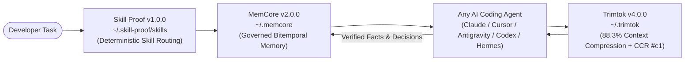

<div align="center">

# trimtok

**Deterministic, Lossless-Retrievable Context Compression for Autonomous AI Agents**

<p><em>88.3% fewer characters across heavy engineering workloads — zero intelligence lost, every byte recoverable in sub-millisecond time.</em></p>

<p>
  <a href="https://github.com/Stxyu-p/trimtok"></a>
  <a href="#performance"></a>
  <a href="#safety-rail-ccr-v2-sqlite-wal--zstd"></a>
  <a href="#quick-start"></a>
  <a href="LICENSE"></a>
</p>

<p>
  <a href="#overview">Overview</a> ·
  <a href="#the-global-agent-trinity-recommended-combo">Global Trinity Combo</a> ·
  <a href="#quick-start">Quick Start</a> ·
  <a href="#live-compression-examples">Live Examples</a> ·
  <a href="#architecture--modules">Architecture</a> ·
  <a href="#safety-rail-ccr-v2-sqlite-wal--zstd">CCR Recovery</a> ·
  <a href="#performance">Performance</a>
</p>

</div>

---

## Overview

**trimtok v4.0.0** intercepts noisy terminal outputs, repetitive test logs, deep stack traces, large `git diff` blocks, and bulky JSON/source-code tool results *before* they consume your model's context window.

It runs **100% locally and offline** with strict fail-open guarantees and a global content-addressed recovery cache (`~/.trimtok`):

1. **Terminal Pipeline (`Stage 1`):** Strips ANSI/spinner noise, collapses intermediate framework stack frames (`site-packages`, `node_modules`), condenses unchanged `git diff` context while keeping file headers and `@@` hunk scopes, folds exact and Drain-template repeats, and turns repeated test/build runs into a compact cross-turn delta.
2. **Tool & Code Pipeline (`Stage 2`):** Deduplicates repeated spans across turns, groups multi-file `grep` hits under enclosing `def`/`class` headers, skeletonizes large source files via **AST Code Skeletonization** (preserving signatures, types, and docstrings while folding function bodies), and transcodes nested JSON payloads into lossless **TOON v2** columnar tables verified by an in-memory round-trip check.
3. **Zstandard + SQLite WAL Recovery (`CCR v2`):** Every compressed output stores its exact, unmodified original in a single-file SQLite WAL + Zstandard store (`trimtok_ccr_v2.sqlite3`), addressable by a short Base62 `#c1` alias with instant section slicing (`errors`, `diff`, `summary`, `tail`), regex grep, or full restoration.

<p align="center">
  
</p>

---

## The Global Agent Trinity (Recommended Combo)

For the complete local-first AI engineering stack, pair **trimtok** with [**MemCore**](https://github.com/Stxyu-p/memcore) and [**Skill Proof**](https://github.com/Stxyu-p/skill-proof). Together, they unify every AI coding client on your machine (**Claude Code, Cursor, Antigravity, Gemini CLI, Codex, VS Code Copilot, Windsurf, OpenCode, Cline, and Hermes**) around three shared global hubs:



| Layer | Engine | Global Hub | What You Gain When Installed Together |
| :--- | :--- | :--- | :--- |
| **1. Skill Routing** | [**Skill Proof v1.0.0**](https://github.com/Stxyu-p/skill-proof) | `~/.skill-proof/skills` | **One Skill Vault, Zero Prompt Bloat:** Deduplicates all `SKILL.md` playbooks into one global vault and selects the exact skill in `< 1 ms` with zero routing LLM calls. |
| **2. Context Shield** | [**Trimtok v4.0.0**](https://github.com/Stxyu-p/trimtok) | `~/.trimtok` | **88.3% Less Context Noise:** Compresses terminal logs, tracebacks, diffs, AST code bodies, and JSON tool outputs while keeping every byte retrievable via `#c1` aliases. |
| **3. Governed Memory** | [**MemCore v2.0.0**](https://github.com/Stxyu-p/memcore) | `~/.memcore` | **One Shared Brain Across All Clients:** Hybrid FTS5 + `sqlite-vec` SIMD + `model2vec` recall with hard trust boundaries, source-hash staleness detection, and tombstone guards. |

### One-Command Trinity Setup

```bash
# 1. Install all three engines with high-speed local accelerators
pip install trimtok memcore skill-proof

# 2. Register stdio MCP servers across all detected AI coding clients & IDEs
trimtok install
memcore install
skill-proof install

# 3. Consolidate dispersed agent skills into the global vault (~/.skill-proof/skills)
skill-proof vault migrate
```

---

## Quick Start

### 1. Universal Auto-Install (MCP + CLI)

Register `trimtok` into every supported AI agent CLI and IDE on your machine with one command:

```bash
pip install trimtok
trimtok install
```

`trimtok install` detects and atomically updates:
- **Claude Code** (`~/.claude.json`) & **Claude Desktop** (`claude_desktop_config.json`)
- **Google Antigravity & Antigravity IDE** (`~/.gemini/config/mcp_config.json`, `~/.gemini/antigravity/mcp_config.json`)
- **Gemini CLI** (`~/.gemini/settings.json`) & **Codex CLI** (`~/.codex/config.toml`)
- **Cursor** (`~/.cursor/mcp.json`), **Windsurf**, **VS Code (Copilot)**, **OpenCode**, and **Cline**

Inspect client registration or run standalone from the terminal:

```bash
trimtok clients                         # Check registration status across all IDEs/CLIs
trimtok status                          # Inspect total savings and CCR SQLite WAL cache stats
trimtok usage                           # View compression breakdown by command/tool shape
cat build.log | trimtok compress        # Compress a noisy log stream from stdin
trimtok retrieve "#c1" --section errors # Slice only error windows from a cached original
trimtok purge                           # Clear cached originals and vacuum SQLite store
```

### 2. Hermes Agent Native Plugin

```bash
# Linux / macOS
git clone https://github.com/Stxyu-p/trimtok.git ~/.hermes/plugins/trimtok

# Windows (PowerShell)
git clone https://github.com/Stxyu-p/trimtok.git "$env:LOCALAPPDATA\hermes\plugins\trimtok"

hermes plugins enable trimtok
```

---

## Live Compression Examples

### 1. Two-Stage Fuzzy Command Delta (`trimtok/delta_engine.py`)
Running `pytest` a second time in the same session (even with shifted line numbers, updated durations, or flag changes like `pytest -v` vs `pytest -q`):

```text
[tt:delta cmd="pytest -q" sim=99% +#1 -#1 !#1 #c2 #c1]
[tt:legend] Delta vs previous run of the same command: + added, - resolved/removed, ! still failing; refs = full snapshots via trimtok_retrieve.
--- STILL FAILING / ACTIVE ERRORS (1) ---
! FAILED test_1000.py::test_boom - AssertionError: expected 1 got 2
--- ADDED / CHANGED IN THIS TURN (+1) ---
+ ===== 1 failed, 200 passed in 43.2s =====
--- RESOLVED / REMOVED (-1) ---
- ===== 1 failed, 200 passed in 42.1s =====
```

### 2. Lossless Hierarchical TOON v2 Table (`trimtok/toon_codec.py`)
Nested JSON tool payloads unnest via dot-notation with shared URL/path prefixes and compact inline JSON cells, verified by a strict in-memory round-trip check (`_strict_eq`):

```text
[tt:legend] TOON table (lossless): "@prefix(A)=base" = shared path shorthand; "@rows[N]{f1,f2}:" header, then N rows, cells split by "|" (quoted = literal).
@prefix(~/)=https://example.com/items/
@meta:{"status":"success"}
@data.results[3]{id,title,url,tags}:
0|Item 0|~/0|["dev","lead"]
1|Item 1|~/1|["qa"]
2|Item 2|~/2|["pm","ops"]
```

### 3. AST Code Skeletonization & Traceback Pruning (`trimtok/pruners.py`)
Large Python/JS/TS/Go/Rust files and deep stack traces are condensed structurally without losing signatures, docstrings, entrypoints, or crash frames:

```text
Traceback (most recent call last):
  File "/app/main.py", line 25, in handle_request
    result = pipeline.process(data)
  [... 3 framework frames omitted ...]
  File "/app/pipeline.py", line 58, in process
    return 100 / count
ZeroDivisionError: division by zero
```

---

## Architecture & Modules

`trimtok v4.0.0` is organized as a clean Python package (`trimtok/`) with top-level compatibility shims so both `import trimtok` and legacy plugin imports work seamlessly:

| Module | Role | Key Responsibilities |
| :--- | :--- | :--- |
| `trimtok/core.py` | **Stage 1: Terminal Pipeline** | Output classification, traceback/diff pruning, ANSI stripping, exact & Drain template folding, BPE non-inflation gate, fault quality gate. |
| `trimtok/dedup.py` | **Stage 2: Tool Pipeline** | Volatile token normalization, JSON minification, AST code skeletonization, cross-turn span/line folding, 3-gram shingle near-dedup, TOON v2 transcoding. |
| `trimtok/pruners.py` | **Structural Pruners** | Unified module housing Python/Node traceback pruning, semantic `git diff` context folding, scoped search grouping, and `ast` code skeletonization. |
| `trimtok/signals.py` | **Fault Rails & BPE Gate** | English/Thai failure polarity rails (`is_important`), `[tt:...]` marker grammar, `tiktoken` BPE estimator with 64 KB fast sampling, and fail-open `Deadline` guard. |
| `trimtok/toon_codec.py` | **Lossless TOON v2 Codec** | Multi-level dot-notation unnesting, `@prefix` extraction, inline compact JSON cells, and strict recursive round-trip verification (`_strict_eq`). |
| `trimtok/delta_engine.py` | **Stateful Command Delta** | Command family normalization, 2-stage line alignment ($O(N)$ skeleton + `rapidfuzz`), `STILL FAILING` canary rail, and bounded per-session LRU state. |
| `trimtok/ccr.py` | **SQLite WAL + Zstd CCR v2** | Single-file `FastCCRStore` (`trimtok_ccr_v2.sqlite3`) with atomic `BEGIN IMMEDIATE` Base62 `#cN` alias generation, Zstandard compression, and TTL eviction. |
| `trimtok/mcp_server.py` | **Stdio MCP Server** | Exposes `trimtok_compress_terminal`, `trimtok_compress_tool`, `trimtok_retrieve`, and `trimtok_status` over `msgspec`-accelerated JSON-RPC 2.0. |
| `trimtok/mcp_install.py` | **Universal Client Installer** | Atomically registers/unregisters `trimtok` across 11 AI agent CLIs and IDEs with automatic `.pre-mcp-install.bak` backups. |

---

## Safety Rail: CCR v2 (SQLite WAL + Zstd)

Every compressed output stores its full, unmodified original in the Content-Addressed Context Recovery (**CCR v2**) store.

| Mode | Example `trimtok_retrieve` Arguments | Behavior |
| :--- | :--- | :--- |
| **Section: Errors** | `{"hash": "#c1", "section": "errors", "context_lines": 3}` | Extracts all fault/error lines via `is_important()` with merged `±context_lines` windows. |
| **Section: Diff** | `{"hash": "#c1", "section": "diff", "context_lines": 3}` | Extracts unified diff headers, `@@` hunk headers, and `+`/`-` changes. |
| **Section: Summary** | `{"hash": "#c1", "section": "summary"}` | Returns line/char counts, error count, head (15 lines), tail (25 lines), and top 20 error lines. |
| **Section: Tail** | `{"hash": "#c1", "section": "tail", "limit": 50}` | Returns the last `limit` lines (`1-indexed`) with line numbers. |
| **Regex Grep** | `{"hash": "#c1", "grep": "ConnectionRefused\|503"}` | Safe bounded regex search across the uncompressed original (`line_no\|text`). |
| **Line Pagination** | `{"hash": "#c1", "offset": 100, "limit": 80}` | Slices lines `100..179` (`1-indexed`) with line numbers. |
| **Full Restore** | `{"hash": "#c1"}` | Returns the complete uncompressed `original_content`. |

---

## Performance

Verified across the 34-case heavy stress suite (`python tests/stress_heavy.py`) and latency benchmark harness (`python tests/test_benchmark.py`):

| Workload / Benchmark | Result | Budget / Target |
| :--- | ---: | ---: |
| **34-case heavy stress suite (`3.56M → 417K chars`)** | **88.3% reduction** (~785k tokens saved) | `> 75.0%` |
| **1 MB repeated tool / 500 KB repeated terminal log** | **99.9% – 100.0% reduction** | `> 95.0%` |
| **`compress_terminal` (4.4 KB repeated build log)** | **1.62 ms** median | `< 10.0 ms` |
| **`compress_tool_result` (JSON + TOON v2 verify)** | **10.29 ms** median | `< 25.0 ms` |
| **`try_delta` (2-stage fuzzy alignment, 200 lines)** | **1.35 ms** median | `< 5.0 ms` |
| **`ccr.put` (SQLite WAL + Zstd) / `ccr.get` (warm `#c1`)** | **0.22 ms / 0.011 ms** | `< 5.0 ms` |

### Verification Suite

```bash
pytest -q
python tests/test_core.py
python tests/test_v3_upgrade.py
python tests/test_dedup.py
python tests/test_torture.py
python tests/test_benchmark.py
python tests/stress_heavy.py
```

---

## License

Distributed under the [MIT License](LICENSE). Designed and maintained by **P Choke & SORA**.
