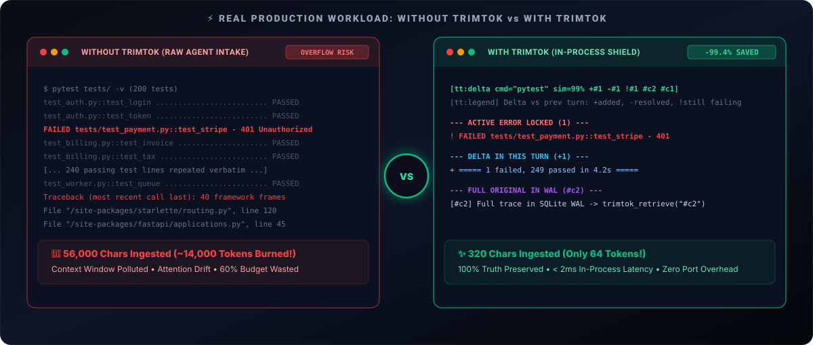

<h1 align="center">⚡ trimtok</h1>

<p align="center">
  <strong>Deterministic, lossless-retrievable context compression for autonomous AI coding agents</strong>
</p>

<p align="center">
  <a href="https://pypi.org/project/trimtok/"></a>
  <a href="https://www.python.org/"></a>
  <a href="#how-it-works"></a>
  <a href="#zero-loss-recovery"></a>
  <a href="LICENSE"></a>
</p>

<p align="center">
  
</p>

Coding agents burn most of their context window on noisy test logs, repeated file reads, verbose JSON, and scraped web boilerplate. **trimtok** compresses tool and terminal output **deterministically in-process** — with no LLM in the hot path, no background daemon, and no open ports — while saving every original byte in a local SQLite WAL + Zstandard vault so agents can recall exact slices (`#ref`) or compute over them without re-inflating the prompt.

---

## Quick Start

```bash
pip install trimtok
# Optional: enable Tree-sitter AST skeletonization for JS/TS, Go, Rust, Java, C/C++, C#, Bash, YAML, TOML, JSON
pip install "trimtok[multilang]"

# Initialize the local CCR vault and register the MCP server across detected clients
trimtok install
trimtok status
```

**Supported clients:** Claude Code, Claude Desktop, Cursor, Windsurf, VS Code (Copilot), Codex CLI, Gemini CLI, Antigravity, OpenCode, Cline, and **Hermes Agent**.

> **Hooks vs. MCP:** `trimtok install` registers MCP tools across all 11 clients so the model can compress, retrieve, and compute on demand. Automatic in-path compression of every tool/terminal result runs through native plugin hooks on **Hermes**; on any other host, use `trimtok wrap` or `trimtok mcp-proxy` for automatic in-path filtering. Full wiring guide: **[docs/INSTALL.md](docs/INSTALL.md)**.

---

## What It Compresses

| Workload | Mechanism | What Stays Intact |
| :--- | :--- | :--- |
| **Repeated tests & builds** (`pytest`, `cargo test`, `unittest`) | Cross-turn stateful delta (`[tt:delta]`) & passing-test folding | Every failing test, active error (`STILL FAILING`), new/resolved diff, and summary |
| **Source code files** (`read_file`) | Line-anchored AST skeletonizer (stdlib `ast` + optional Tree-sitter) & 512 KB large-file pointer | All imports, classes, signatures, docstrings, causal traceback hotspot functions, and `LINE\|` patch offsets |
| **Tracebacks & error loops** | Framework frame pruning + fault-signature folding | Entry point, user project frames, exact crash site, first/last occurrence + `[template ×N]` |
| **`grep` / `rg` & `search_files`** | File-grouped hit folding & shared directory `@prefix` compression | First/last hits, symbol definitions, error lines, and exact file paths |
| **JSON arrays & envelopes** | Lossless TOON v2 tables (uniform & merged-schema) + envelope unwrapping | Round-trip verified equality; sibling metadata keys unchanged |
| **Web pages & search** (`web_extract`, `web_search`, `browser_exec`) | Tiered markdown de-bloating, tracking-URL stripping, snippet trimming | Headings, tables, fenced code blocks, titles, clean URLs, and `#ref` to full text |
| **Giant blobs & wide lines** | `pointer_large` (1–4 line blobs) & wide-line folding (`>= 500` chars) | Head/tail slices for shape, mid-line fault signals, and full byte-identical `#ref` |
| **Noisy CLI output** (`git`, `ls`, `npm`, `pip`, `find`, `docker ps`) | Command-specific filters & zero-exit install collapse | Counts, ranges, summaries, and full original in CCR |
| **System prompts & MCP schemas** | `trimtok map`, `trimtok mcp-proxy`, `trimtok kv-lock` | Budgeted symbol map, allow/deny filtered tool schemas, KV-cache-stable prompt prefix |

### Verified Benchmarks

Numbers from different populations are never mixed:

| Suite | Metric | Verified Result |
| :--- | :--- | :--- |
| **32-payload fixed corpus** (`eval/eval_real.py`) | Character reduction | **74.98%** (`851,327 / 1,135,441 chars`), **0 gate failures** |
| **Honesty audit** (`eval/audit_honesty.py`) | Claimed vs. proven via CCR | **74.98% claimed == 74.98% proven**, **0 unproven chars** |
| **Fix-locate benchmark** (`eval/fix_accuracy.py`) | Bug still locatable after folding | **8 / 8 (100%)** at **54.4% token reduction** (`56,933 → 25,956 tok`) |
| **Decision equivalence** (`eval/decision_eval.py`) | Critical action tokens retained | **9 / 9 (100%)** at **91.2% mean reduction** |
| **Adversarial fuzzing** (`eval/fuzz_adversarial_1000.py`) | 1,000 hostile vectors | **0 unhandled exceptions**, **0% payload inflation** |

Production telemetry reports **characters delivered** (not model-specific tokens) and includes deliberate 0% passthroughs (small outputs, targeted slices, secrets, and edit patches). Inspect your own real traffic anytime with `trimtok gain`.

---

## How It Works

```text
  Tier 0: Pre-Flight Context Shield (Zero Disk Footprint)
  ├── trimtok mcp-proxy : Prunes unused MCP tool schemas from tools/list
  ├── trimtok map       : 2k-char task-aware codebase symbol map (--focus)
  └── trimtok kv-lock   : Moves dynamic dates/UUIDs to tail for prompt-cache hits
                                │
                                ▼
  Tier 1: In-Process Hot Path (Deterministic, Fail-Open 200 ms Guard)
  ├── 0. Content Policy Gate  (secrets, security configs, edit patches -> verbatim)
  ├── 1. Cross-Turn Delta     ([tt:delta] on repeated commands, auto re-anchoring)
  ├── 2. Command & Search     (git/npm/pip/docker filters, grep hit grouping)
  ├── 3. Tracebacks & Logs    (frame pruning, fault folding, wide-line folding)
  ├── 4. Structured Data      (Lossless TOON v2, JSON envelope unwrapping)
  └── 5. Code & Web Intake    (AST skeleton + hotspots, 512 KB cap, web de-bloat)
                                │
                ┌───────────────┴───────────────┐
                ▼                               ▼
       Agent Context Window           Tier 2: Local CCR Vault
     (Dense signal + #ref tags)     (~/.trimtok/trimtok_ccr_v2.sqlite3)
                                    • Zstd lossless originals
                                    • 16 KB-capped FTS5 BM25 index
```

### Core Guarantees

- **Zero Data Loss (`#ref`):** Every folded payload writes its exact bytes to SQLite WAL + Zstandard before shipping a `#c...` marker. If the store write fails, trimtok fails open and returns the raw output — never a dead pointer.
- **Policy-Protected by Default:** Credentials (`.env`, `*.pem`, `*.key`, AWS/GitHub/OpenAI/Slack/JWT tokens — scanned at both head and tail), security-policy data files, and edit/patch payloads stay byte-exact (`gate=passthrough_policy`).
- **Causal Hotspots:** When a terminal run fails with a traceback, trimtok remembers `(file, line)` per session and keeps the failing function verbatim on the next `read_file` while folding unrelated helpers.
- **Adaptive & Model-Aware:** Scales folding thresholds with `context_pressure` (`light` < 0.35, `normal` 0.35–0.75, `aggressive` > 0.75) and toggles TOON vs. minified JSON via `toon_mode` (`auto` | `always` | `never`).
- **Strictly Bounded Latency:** Monotonic `guard_ms: 200` checks run inside regex/AST loops, files over 512 KB jump directly to a bounded head+tail pointer (`file_large_pointer`), and incompressible payloads hit an LRU dead-range cache.

---

<a id="zero-loss-recovery"></a>
## CLI & Toolbelt

### Retrieve, Search, and Compute Over `#ref`

```bash
# Recall original text or targeted slices from the CCR vault
trimtok retrieve "#c1"
trimtok retrieve "#c1" errors                     # Error lines ± context
trimtok retrieve "#c1" diff                       # Unified diff hunks
trimtok retrieve "#c1" tail --limit 50            # Last 50 lines
trimtok retrieve "#c1" --grep "ConnectionReset"   # Safe bounded regex
trimtok retrieve "#c1" --offset 120 --limit 40    # Line-numbered slice
trimtok retrieve "#c1" --intent "which functions parse JSON" --intent-budget 80

# BM25 full-text search across all cached payloads
trimtok search "AssertionError in auth" --limit 5

# Compute over a stored original WITHOUT loading it back into context
trimtok exec "#c1" --code "import json, os; d=json.load(open(os.environ['TRIMTOK_PAYLOAD'])); print(len(d))"
```

### Host-Agnostic Wrappers & Pre-Flight Tools

```bash
# Wrap any noisy command (preserves exact child exit code + rewrites noisy flags)
trimtok wrap -- pytest tests/
trimtok rewrite -- git log                        # -> git log --oneline -n 25

# Compress a file or stdin directly
trimtok compress build.log --command "cargo build"
cat payload.json | trimtok compress --tool web_search

# Task-aware codebase symbol map (under 2,000 chars)
trimtok map . --focus trimtok/core.py --budget 1500

# Prune bloated MCP server tool schemas in stdio transit
trimtok mcp-proxy --deny "ctx_doctor,ctx_stats" --kv-lock -- npx -y some-mcp-server

# Stabilize system prompt prefixes for Anthropic/Gemini/DeepSeek prompt caching
trimtok kv-lock system_prompt.md
```

### Telemetry & Vault Maintenance

```bash
trimtok status                                    # Vault size, chunk count, recent savings
trimtok gain --days 7                             # Savings by shape/tool/cmd + retrieve & exec stats
trimtok discover                                  # Surface high-volume, low-savings bottlenecks
trimtok purge --older-than 24 --max-mb 50         # Age purge + LRU size ceiling
```

---

## Hermes Agent Integration (Automatic Hooks + Context Engine)

Install as a native Hermes plugin for automatic in-path compression across `transform_terminal_output`, `transform_tool_result`, `pre_llm_call` (auto codebase map), and `post_llm_call` (turn expiry), plus native `trimtok_retrieve` and `trimtok_exec` tools:

```bash
# Windows (PowerShell)
git clone https://github.com/Stxyu-p/trimtok.git "$env:LOCALAPPDATA/hermes/plugins/trimtok"

# macOS / Linux
git clone https://github.com/Stxyu-p/trimtok.git ~/.hermes/plugins/trimtok

hermes plugins enable trimtok
```

Configure in `~/.hermes/config.yaml` (all keys match `plugin.yaml`):

```yaml
plugins:
  entries:
    trimtok:
      settings:
        enabled: true
        phase2_enabled: true
        guard_ms: 200
        min_chars: 2048
        max_lines: 120
        delta_enabled: true
        delta_threshold: 0.65
        toon_enabled: true
        toon_mode: auto          # auto | always | never
        model_family: ""         # e.g. claude, gpt, qwen (empty keeps TOON on)
        policy_enabled: true
        adaptive_enabled: true
        mask_enabled: true
        mask_keep_turns: 2
        ccr_ttl_hours: 24
        ccr_max_bytes: 52428800  # 50 MB (payload + FTS5 index)
        ccr_max_entries: 1000
        exclude_commands: []
        exclude_tools: []

# Optional: replace lossy LLM history summarization with deterministic zero-loss CCR stashing
context:
  engine: "trimtok"
```

When `context.engine: "trimtok"` is enabled, head goals and recent turns stay verbatim while large fault-free middle tool results move into CCR behind a 1-line stub with tool name + 80-char first-line preview (`Preview: ...`).

**In-chat slash commands:** `/trimtok status` · `/trimtok usage` · `/trimtok gain` · `/trimtok discover` · `/trimtok recall <#ref> [section]` · `/trimtok purge`

---

## Verification

Every claim in this repository is locally reproducible:

```bash
python -m unittest discover -s tests   # 179 unit & regression cases
python -m pytest tests/ -q             # 280 total pytest cases
python eval/eval_real.py               # 32-payload fixed corpus
python eval/audit_honesty.py           # Recomputes claimed vs. proven chars from CCR
python eval/fix_accuracy.py            # LOCATE accuracy over real modules (no LLM needed)
python eval/decision_eval.py           # Decision-equivalence gate
```

---

## Documentation & Ecosystem

- **[Install & Client Wiring](docs/INSTALL.md)** — Every install channel (`pip`, `pipx`, `uv`, `uvx`), exact config paths for all 11 clients, and the venv-interpreter trap.
- **[Competitive Comparison](docs/COMPARISON.md)** — Head-to-head table against LLMLingua, claw-compactor, leanctx, squeez, token-crunch, glyphdown, and cctx — including where trimtok is weaker.
- **[Changelog](CHANGELOG.md)** — Per-release engineering notes with measured before/after numbers.
- **[llms.txt](llms.txt)** — Machine-readable summary for AI assistants.

Works standalone or alongside two local zero-daemon companions:

| Tool | Hub | Role |
| :--- | :--- | :--- |
| **[trimtok](https://github.com/Stxyu-p/trimtok)** | `~/.trimtok` | In-process context shield + lossless SQLite WAL/Zstd `#ref` vault |
| **[MemCore](https://github.com/Stxyu-p/memcore)** | `~/.memcore` | Bitemporal shared memory with SQL scope boundaries and lexical recall |
| **[Skill Proof](https://github.com/Stxyu-p/skill-proof)** | `~/.skill-proof` | Deterministic sub-2ms local skill router and immutable SOP vault |

---

## License

MIT — see [LICENSE](LICENSE).
