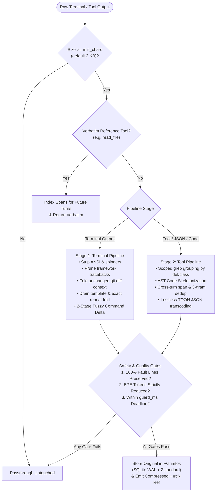
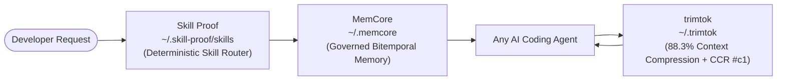

<div align="center">

# trimtok

**Universal, Local, Deterministic Context Compressor for AI Coding Agents & IDEs**

<p><em>88.3% fewer characters across heavy engineering workloads — zero intelligence lost, every byte recoverable in sub-millisecond time.</em></p>

<p>
  <a href="https://pypi.org/project/trimtok/"></a>
  <a href="#performance--benchmarks"></a>
  <a href="#core-engineering-guarantees"></a>
  <a href="#content-addressed-context-recovery-ccr"></a>
  <a href="#quick-start"></a>
  <a href="LICENSE"></a>
</p>

<p>
  <a href="#why-trimtok">Why trimtok</a> ·
  <a href="#visual-before--after-showcase">Before / After</a> ·
  <a href="#quick-start">Quick Start</a> ·
  <a href="#how-the-dual-stage-pipeline-works">How It Works</a> ·
  <a href="#content-addressed-context-recovery-ccr">CCR Recovery</a> ·
  <a href="#v42-stateful-file--adaptive-context-engine">v4.2 Engine</a> ·
  <a href="#architecture--modules">Architecture</a> ·
  <a href="#performance--benchmarks">Performance</a> ·
  <a href="#configuration--cli-reference">Configuration</a> ·
  <a href="#recommended-ecosystem-combo">Trinity Combo</a>
</p>

</div>

---

## Why trimtok?

Autonomous coding agents burn 60%–85% of their context window on **high-volume, low-entropy noise**: 2,000-line passing `pytest` runs, deep framework stack frames (`site-packages`, `node_modules`), unchanged `git diff` context lines, repetitive `grep` matches, and deeply nested JSON tool responses.

Naive truncation (`head -n 50` or character slicing) destroys critical failure signals hidden in the middle of logs. Summarizing via a secondary LLM adds seconds of latency and risks hallucinating line numbers or error codes.

**trimtok** solves this deterministically, 100% locally and offline, in **~1–2 ms**:

- **Stage 1 — Terminal Pipeline (`compress_terminal`):** Strips ANSI/spinner artifacts, prunes intermediate framework stack frames while preserving entrypoints and crash sites, condenses unchanged `git diff` context while keeping file headers and `@@` hunk scopes, folds exact and Drain-template log repeats, and turns repeated test/build commands into a compact **Cross-Turn Stateful Delta**.
- **Stage 2 — Tool & Code Pipeline (`compress_tool_result`):** Deduplicates repeated spans across turns, groups multi-file `grep` hits under enclosing `def`/`class` scopes, condenses large source files via **AST Code Skeletonization** (keeping imports, signatures, type annotations, and docstrings while folding function bodies), and transcodes nested JSON payloads into lossless **Hierarchical TOON Tables** verified by an in-memory round-trip check.
- **Safety Rail — Content-Addressed Context Recovery (`CCR`):** Every compressed payload stores its exact, unmodified original in a global SQLite WAL + Zstandard store (`~/.trimtok`), addressable by a short Base62 `#c1` alias with instant section slicing (`errors`, `diff`, `summary`, `tail`), safe regex grep, or full restoration.

> [!IMPORTANT]
> **Zero Intelligence Loss Invariant:** Every error, exception, traceback crash site, compiler diagnostic, HTTP 5xx status, and Thai/English failure line is locked by fault polarity rails (`is_important`) and is **never** dropped or folded away. If any transformation fails to strictly reduce both character count and BPE token count, `trimtok` immediately reverts to the untouched original string.

<p align="center">
  
</p>

---

## Visual Before & After Showcase

### 1. Cross-Turn Stateful Command Delta (`delta_engine.py`)
When an agent runs `pytest` a second time after editing code (even with shifted line numbers, updated timings, or flag changes like `pytest -v` vs `pytest -q`):

<table>
<tr>
<th width="50%">Raw Terminal Output (56,108 chars)</th>
<th width="50%">trimtok Compressed Output (312 chars — 99.4% saved)</th>
</tr>
<tr>
<td>

```text
============================= test session starts =============================
platform win32 -- Python 3.12.4, pytest-8.3.2, pluggy-1.5.0
rootdir: /workspace/app
collected 201 items

tests/test_auth.py ............................                         [ 13%]
tests/test_db.py ...................................................... [ 40%]
tests/test_api.py ..................................................... [ 67%]
... (1,950 lines of passing test output & noisy INFO logs) ...
================================== FAILURES ===================================
__________________________________ test_boom __________________________________
    def test_boom():
>       assert compute_status() == 1
E       AssertionError: expected 1 got 2
=========================== short test summary info ===========================
FAILED tests/test_1000.py::test_boom - AssertionError: expected 1 got 2
======================== 1 failed, 200 passed in 43.2s ========================
```

</td>
<td>

```text
[tt:delta cmd="pytest -q" sim=99% +#1 -#1 !#1 #c2 #c1]
[tt:legend] Delta vs previous run of the same command: + added, - resolved/removed, ! still failing; refs = full snapshots via trimtok_retrieve.
--- STILL FAILING / ACTIVE ERRORS (1) ---
! FAILED test_1000.py::test_boom - AssertionError: expected 1 got 2
--- ADDED / CHANGED IN THIS TURN (+1) ---
+ ===== 1 failed, 200 passed in 43.2s =====
--- RESOLVED / REMOVED (-1) ---
- ===== 1 failed, 200 passed in 42.1s =====
```

</td>
</tr>
</table>

### 2. Lossless Hierarchical TOON JSON Transcoding (`toon_codec.py`)
Verbose JSON arrays and API responses are unnested via dot-notation, common URL/path prefixes are factored into `@prefix`, and every table is decoded in-memory to verify recursive strict equality (`_strict_eq`) before emission:

<table>
<tr>
<th width="50%">Raw JSON Tool Payload</th>
<th width="50%">Lossless TOON Table (74.3% fewer tokens)</th>
</tr>
<tr>
<td>

```json
{
  "meta": {"status": "success"},
  "data": {
    "results": [
      {
        "id": 0,
        "title": "Item 0",
        "url": "https://example.com/items/0",
        "tags": ["dev", "lead"]
      },
      {
        "id": 1,
        "title": "Item 1",
        "url": "https://example.com/items/1",
        "tags": ["qa"]
      },
      {
        "id": 2,
        "title": "Item 2",
        "url": "https://example.com/items/2",
        "tags": ["pm", "ops"]
      }
    ]
  }
}
```

</td>
<td>

```text
[tt:legend] TOON table (lossless): "@prefix(A)=base" = shared path shorthand; "@rows[N]{f1,f2}:" header, then N rows, cells split by "|" (quoted = literal).
@prefix(~/)=https://example.com/items/
@meta:{"status":"success"}
@data.results[3]{id,title,url,tags}:
0|Item 0|~/0|["dev","lead"]
1|Item 1|~/1|["qa"]
2|Item 2|~/2|["pm","ops"]
```

</td>
</tr>
</table>

### 3. Structured Traceback Pruning & AST Code Skeletonization (`pruners.py`)
Deep stack traces collapse intermediate library frames (`site-packages`, `node_modules`) while keeping 100% of the entrypoint, user project frames, crash frame, and exception line. Large source files keep class/function signatures, type annotations, and docstrings while folding long implementation bodies:

```text
Traceback (most recent call last):
  File "/app/main.py", line 25, in handle_request
    result = pipeline.process(data)
  [... 14 framework frames in site-packages/starlette & fastapi omitted ...]
  File "/app/pipeline.py", line 58, in process
    return 100 / count
ZeroDivisionError: division by zero
```

---

## Quick Start

### 1. Universal One-Command Auto-Install (Recommended)

Install `trimtok` and automatically register its stdio MCP server across every supported AI agent CLI and IDE on your machine:

```bash
pip install trimtok
trimtok install
```

`trimtok install` detects and atomically updates:
- **Claude Code** (`~/.claude.json` via `claude mcp add-json`) & **Claude Desktop** (`claude_desktop_config.json`)
- **Google Antigravity & Antigravity IDE** (`~/.gemini/config/mcp_config.json`, `~/.gemini/antigravity/mcp_config.json`)
- **Gemini CLI** (`~/.gemini/settings.json`) & **Codex CLI** (`~/.codex/config.toml` with TOML validation)
- **Cursor** (`~/.cursor/mcp.json`), **Windsurf**, **VS Code (Copilot)**, **OpenCode**, and **Cline**

> [!TIP]
> Every client config edit creates an automatic backup (`.pre-mcp-install.bak`) and preserves all existing MCP servers. Run `trimtok clients` anytime to inspect registration status across your machine.

### 2. Standalone CLI Usage

```bash
# Inspect compression savings and global CCR cache health (~/.trimtok)
trimtok status

# View telemetry breakdown by command shape and retrieval hit rates
trimtok usage

# Compress any noisy log or file directly from shell pipelines
cat build.log | trimtok compress
trimtok compress --file pytest_output.txt

# Retrieve uncompressed originals or targeted sections by #cN alias
trimtok retrieve "#c1"
trimtok retrieve "#c1" --section errors
trimtok retrieve "#c1" --section diff

# Purge expired or all cached originals and vacuum SQLite store
trimtok purge
```

### 3. Hermes Agent Native Plugin

```bash
# Linux / macOS
git clone https://github.com/Stxyu-p/trimtok.git ~/.hermes/plugins/trimtok

# Windows (PowerShell)
git clone https://github.com/Stxyu-p/trimtok.git "$env:LOCALAPPDATA\hermes\plugins\trimtok"

hermes plugins enable trimtok
```

---

## How the Dual-Stage Pipeline Works



### Core Engineering Guarantees

| Guarantee | Mechanism |
| :--- | :--- |
| **Zero Intelligence Loss** | Error, exception, traceback crash site, HTTP 5xx, and Thai/English failure lines (`signals.py`) are locked by fault rails and never folded or dropped. |
| **BPE Non-Inflation Gate** | Every candidate output is checked via `estimate_bpe_tokens()`. If compression does not strictly reduce both character count and token count, `trimtok` returns the original input. |
| **Stateful File-Edit Safety** | Direct file reads (`read_file`) maintain patch safety via a 3-tier stateful engine: targeted slices and cold reads under 12 KB remain 100% verbatim, while re-reads emit structural outlines or contextual line-anchored deltas with exact line coordinates. |
| **Lossless TOON Round-Trip** | `toon_codec.py` decodes every generated columnar table back into Python objects in memory and verifies strict recursive type-and-value equality (`_strict_eq`) before emitting. |
| **Fail-Open Deadline Guard** | A monotonic `Deadline` timer (`guard_ms`, default `50 ms`) bounds every stage. Any timeout or unexpected exception immediately returns the untouched original text. |
| **Cross-Turn Freshness Masking** | `post_llm_call` automatically ages out fold pointers older than `mask_keep_turns` (default `2` turns) so the agent never references stale turn stubs. |

---

## Content-Addressed Context Recovery (CCR)

Whenever `trimtok` compresses an output, the full unmodified original is persisted in the global **CCR Store** (`~/.trimtok/trimtok_ccr_v2.sqlite3`) using SQLite WAL mode and Zstandard payload compression.

### `trimtok_retrieve` Modes (MCP & CLI)

| Retrieval Mode | MCP Arguments | What It Returns |
| :--- | :--- | :--- |
| **Section: Errors** | `{"hash": "#c1", "section": "errors", "context_lines": 3}` | Scans original via `is_important()`, merges overlapping `±context_lines` windows, and returns `line_no\|text` fault chunks. |
| **Section: Diff** | `{"hash": "#c1", "section": "diff", "context_lines": 3}` | Extracts unified diff file headers, `@@` hunk scopes, and `+`/`-` changes with surrounding context. |
| **Section: Summary** | `{"hash": "#c1", "section": "summary"}` | Returns total line/char counts, error line count, first 15 lines, last 25 lines, and top 20 error lines. |
| **Section: Tail** | `{"hash": "#c1", "section": "tail", "limit": 50}` | Returns the last `limit` lines (default `50`, max `1,000`) with 1-indexed line numbers. |
| **Safe Regex Grep** | `{"hash": "#c1", "grep": "ConnectionRefused\|503"}` | Case-insensitive bounded regex search across the uncompressed original (`line_no\|text`). |
| **Line Pagination** | `{"hash": "#c1", "offset": 100, "limit": 80}` | Slices lines `100..179` (`1-indexed`) with line numbers. |
| **Full Restore** | `{"hash": "#c1"}` | Restores the complete uncompressed `original_content`. |

---

## v4.2 Stateful File & Adaptive Context Engine

Trimtok v4.2 resolves three structural bottlenecks identified across 9,303 production telemetry events: uncompressed `read_file` payloads (1,107 calls, 5,966,692 characters at 0.0% reduction), false-positive gate reversions (`reverted_gate` occurring 558 times at a 6.0% failure rate), and uncompressed payloads in the 1 KB to 2 KB range (`passthrough_small` accounting for 1,306 events or 24.1% of telemetry).

### 1. Three-Tier Stateful File Engine (`_handle_read_file_v42`)

Previous architectures passed direct file reads through verbatim to avoid breaking downstream file-editing tools (`patch`, `edit_file`). The v4.2 engine implements stateful, content-addressed session tracking across three tiers with deterministic cache invalidation:

| Tier | Lifecycle State | Compression Mechanism | Intelligence Guarantee |
| :--- | :--- | :--- | :--- |
| **Rule 0: Targeted Slice & Small File** | Targeted slice (`offset` or `limit` specified) or cold file `< 2,048 chars`. | Returns 100% verbatim content (`passthrough_reference`). | Full line continuity for targeted inspection and small script modifications. |
| **Tier 1: Unchanged Repeat Read** | File re-read with identical content (matching 12-character SHA-256 digest within active session turns). | Emits `[tt:file_unchanged #digest path="..." (chars, lines)]` accompanied by a structural AST outline. | Full outline exposed; exact lines recoverable via `read_file(offset, limit)` or `trimtok_retrieve(hash="#digest", offset, limit)`. |
| **Tier 2: Mutated Re-Read** | File re-read following an edit (matching file path, differing digest). | Emits a contextual line-numbered delta showing modified code with plus-or-minus 15 lines of real surrounding context, folding unchanged spans. | Exact 1-indexed line numbers (`L1..LN`) preserved around all modified hunks; downstream patch tools retain necessary match anchors. |
| **Tier 3: Cold Oversize Read** | Cold first read of files `>= 12,000 chars` (cold files between 2,048 and 11,999 chars are emitted verbatim for single-turn patch safety). | Folds function and class bodies exceeding 15 lines into line-anchored syntax stubs via `smart_skeletonize_code`. | Imports, constants, decorators, complete signatures, type hints, docstring opening lines, and terminal return/raise statements are preserved verbatim. |

Cache entries invalidate deterministically when file-modifying tools (`patch`, `write_file`, `edit_file`, `replace_in_file`, `apply_patch`, `multi_edit`) execute against a tracked path, or when shell modification commands (`git checkout`, `git reset`, `sed -i`) are observed in the terminal pipeline. Expired turn entries are pruned when exceeding `mask_keep_turns`.

### 2. Adaptive Header Scaling & Cascade Gate Rescue (`adaptive_terminal_head`, `adaptive_tool_head`)

In earlier releases, static header and legend overhead (~160 to 180 characters, ~45 to 55 tokens) exceeded the character reduction achieved on small to medium outputs, causing 558 `reverted_gate` rollbacks. The v4.2 engine scales marker overhead dynamically across four tiers:

| Tier | Condition | Header Format & Overhead | SQLite Storage |
| :--- | :--- | :--- | :--- |
| **Tier 0: Headerless Lossless** | Lossless hygiene, ANSI stripping, or JSON minification with zero hidden or dropped lines. | No header emitted (`0 chars` / `0 tokens`). | Skipped (eliminates disk I/O; complete payload preserved in output). |
| **Tier 1: Nano Header** | Payloads 500 to 4,096 chars, or gross savings under 240 chars. | `[tt:#c1 -18L]` or `[tt:#c1 -320c]` (`13–16 chars` / `~4 tokens`). | Cached in CCR for retrieval via `#c1`. |
| **Tier 2: Compact One-Line** | Payloads 4,097 to 8,192 chars with gross savings of 240 chars or more. | `[tt:kind -45L #c1 \| retrieve(hash="#c1", section="errors\|diff\|tail")]` (`48–68 chars` / `~14 tokens`). | Cached in CCR with multi-section retrieval targets. |
| **Tier 3: Full Diagnostic** | Payloads exceeding 8,192 chars with gross savings of 400 chars or more. | Full diagnostic head and usage legend (`160–180 chars` / `~48 tokens`). | Cached in CCR with full diagnostic metadata. |

**Cascade Gate Rescue:** If candidate output with a Tier 2 or Tier 3 header fails the BPE non-inflation gate, the engine automatically attempts re-encoding using a Tier 1 Nano Header. If token reduction remains non-viable, any lossless transformations are emitted as Tier 0 without a header. The engine only reverts to the raw output if lossless compression also fails to yield net token savings.

### 3. Sub-Millisecond Micro-Minification Lane (`micro_minify_tool`)

Payloads between 512 and 2,047 characters are routed through a dedicated fast lane executing in under 0.25 ms without emitting header bloat:

1. **Terminal Hygiene:** Strips ANSI escape sequences and non-essential progress spinner rows while preserving error and diagnostic lines.
2. **Whitespace Normalization:** Removes trailing spaces and tabs, collapsing consecutive blank lines exceeding two down to a single blank line (unified diff outputs are preserved untouched).
3. **Lossless JSON Minification:** Compacts pretty-printed JSON structures through an in-memory pass, removing structural whitespace while preserving key order, data types, and values.
4. **Adjacent Repeat Folding:** Collapses runs of four or more consecutive identical non-error lines into `[repeated Nx]` using a Tier 1 nano header when net savings exceed 60 characters.

### 4. Zero-Loss-of-Intelligence Guarantee

Every compression pass enforces strict verification constraints:

- **Syntax Validity:** Python code skeletonized through `smart_skeletonize_code` is validated to parse under `ast.parse` with zero syntax errors. Non-Python sources fall back safely to scope-aware indentation parsing or verbatim passthrough.
- **Full Signature and Type Preservation:** Function and class definitions, type annotations, decorators, and module-level constants are never pruned. Short functions (15 lines or fewer) remain 100% verbatim.
- **Line-Anchored Re-Reading:** Every folded function body emits an explicit comment stub containing exact 1-indexed line ranges and content-addressed references:
  ```python
  # [tt:body L142-L218 (77 lines) in #c4 -> read_file(offset=142, limit=77) or trimtok_retrieve(hash="#c4", offset=142, limit=77)]
  ```
- **Fault Line Immutability:** Traceback crash locations, error diagnostics, compiler failures, HTTP 5xx codes, and failure indicators identified by `is_important` cannot be folded or dropped.
- **Fail-Open Boundaries:** A monotonic deadline guard (`guard_ms`) terminates processing and returns raw inputs if execution exceeds the allocated time budget.

---

## Architecture & Modules

| Module | Role | Key Responsibilities |
| :--- | :--- | :--- |
| `trimtok/core.py` | **Stage 1: Terminal Pipeline** | Output classification, traceback/diff pruning, ANSI/spinner stripping, exact & Drain template folding, command budgets, terminal micro-minification, Cascade Gate Rescue, and BPE non-inflation gate. |
| `trimtok/dedup.py` | **Stage 2: Tool Pipeline** | Three-tier stateful file engine (`_handle_read_file_v42`), micro-minification fast lane (`micro_minify_tool`), volatile token normalization, JSON minification, cross-turn span folding, 3-gram shingle near-dedup, and TOON transcoding. |
| `trimtok/pruners.py` | **Structural Pruners** | Unified module housing Python/Node stack-trace pruning, semantic `git diff` context folding, scoped search (`def`/`class`) grouping, and line-anchored AST smart code skeletonization (`smart_skeletonize_code`). |
| `trimtok/signals.py` | **Fault Rails, BPE & Guard** | English/Thai failure polarity detector (`is_important`), `[tt:...]` marker grammar, four-tier adaptive header scaling (`adaptive_terminal_head`, `adaptive_tool_head`), `tiktoken` BPE estimator with 64 KB fast sampling, and fail-open `Deadline` guard. |
| `trimtok/toon_codec.py` | **Lossless TOON Codec** | Multi-level dot-notation wrapper unnesting, shared path `@prefix` extraction, inline compact JSON cells (`<= 120 chars`), and in-memory `_strict_eq()` verification. |
| `trimtok/delta_engine.py` | **Stateful Command Delta** | Safe command family normalization, 2-stage line alignment ($O(N)$ skeleton + `rapidfuzz`), `STILL FAILING` canary rail, and bounded per-session LRU state. |
| `trimtok/ccr.py` | **SQLite WAL + Zstd CCR Store** | Single-file `FastCCRStore` with atomic `BEGIN IMMEDIATE` Base62 `#cN` alias generation, Zstandard compression, cross-instance persistence, and TTL eviction. |
| `trimtok/mcp_server.py` | **Stdio MCP Server** | Exposes `trimtok_compress_terminal`, `trimtok_compress_tool`, `trimtok_retrieve`, and `trimtok_status` over `msgspec`-accelerated JSON-RPC 2.0. |
| `trimtok/mcp_install.py` | **Universal Client Installer** | Atomically registers/unregisters `trimtok` across 11 AI agent CLIs and IDEs with automatic `.pre-mcp-install.bak` backups. |

---

## Performance & Benchmarks

### Latency Benchmarks (`python tests/test_benchmark.py`)

| Execution Path | Workload Scenario | Measured Median | P95 | Budget |
| :--- | :--- | ---: | ---: | ---: |
| `compress_terminal` | 4.4 KB repeated build log | **1.62 ms** | 3.53 ms | `< 10.0 ms` |
| `compress_tool_result` (first-seen) | Pretty JSON + TOON round-trip verify | **10.29 ms** | 15.10 ms | `< 25.0 ms` |
| `compress_tool_result` (repeat) | Exact-repeat passthrough | **0.08 ms** | 0.20 ms | `< 10.0 ms` |
| `compress_tool_result` (cross-turn) | 60 shared lines folded against session index | **2.65 ms** | 5.52 ms | `< 10.0 ms` |
| `fast_json_loads` | 1,000 JSON objects (~100 KB) | **0.70 ms** | — | `< 15.0 ms` |
| `estimate_bpe_tokens` | ~96 KB text (with 64 KB fast sampling) | **0.66 ms** | — | `< 20.0 ms` |
| `try_delta` (2-stage fuzzy) | 200-line command output with shifted lines | **1.35 ms** | — | `< 5.0 ms` |
| `ccr.put` / `ccr.get` | SQLite WAL + Zstd write / warm `#c1` read | **0.22 ms / 0.011 ms** | 0.42 ms / 0.012 ms | `< 5.0 ms` |

<details>
<summary><strong>📊 Click to expand: Full 34-Case Heavy Stress Suite Breakdown (88.3% Total Reduction)</strong></summary>

<br/>

Verified via `python tests/stress_heavy.py`:

| Workload Scenario | Before → After | Reduction |
| :--- | :--- | ---: |
| 1 MB repeated tool output (`D12`) | `1,000,000 → 159 chars` | **100.0%** |
| 500 KB repeated terminal log (`T14`) | `500,000 → 250 chars` | **100.0%** |
| 5,000-line heartbeat log (`T1`) | `234,999 → 224 chars` | **99.9%** |
| 2,000-line `pytest` output + 1 failure (`T2`) | `56,108 → 312 chars` | **99.4%** |
| 5-turn repeated `pytest` loop with Delta (`D16`) | `210,725 → 3,136 chars` | **98.5%** |
| Cross-turn search vs prior `read_file` (`D5b`) | `47,500 → 1,070 chars` | **97.7%** |
| 2,000-line Thai + English mixed log (`T11`) | `58,422 → 1,734 chars` | **97.0%** |
| Scoped multi-file grep search (`D14`) | `42,783 → 1,639 chars` | **96.2%** |
| 800-file `git diff` output (`T4`) | `46,760 → 2,110 chars` | **95.5%** |
| 3,000-line error-dense log (`T9`) | `141,779 → 9,214 chars` | **93.5%** |
| 4,800-line deep stack traceback (`T12`) | `94,656 → 11,230 chars` | **88.1%** |
| 1,000-row JSON array via TOON (`D15b`) | `101,885 → 26,147 chars` | **74.3%** |
| Realistic 5-turn mixed session (`SIM`) | `105,839 → 39,904 chars` | **62.3%** |
| **All 34 stress cases combined** | **`3,559,894 → 417,581 chars`** | **88.3%** (~785k tokens saved) |

</details>

---

## Configuration & CLI Reference

### MCP Tools Exposed (`trimtok.mcp_server`)

| MCP Tool | Description |
| :--- | :--- |
| **`trimtok_compress_terminal`** | Compress noisy shell/terminal output while preserving 100% of errors, tracebacks, and diff hunks; stores original in CCR (`#c1`). |
| **`trimtok_compress_tool`** | Compress structured tool/JSON/search/code outputs via TOON tables, scoped search grouping, AST skeletonization, and cross-turn span folding. |
| **`trimtok_retrieve`** | Retrieve uncompressed original content or targeted sections (`errors`, `diff`, `summary`, `tail`, regex `grep`, or line pagination) by `#c1` ref. |
| **`trimtok_status`** | Inspect token savings, CCR cache stats, or purge expired entries. |

<details>
<summary><strong>⚙️ Click to expand: Full Configuration Schema & Hermes Settings</strong></summary>

<br/>

| Setting | Type | Default | Description |
| :--- | :---: | :---: | :--- |
| `enabled` | `bool` | `true` | Master switch for all hooks (`false` = passthrough). |
| `guard_ms` | `float` | `50` | Fail-open deadline budget in milliseconds (`1–1000`). |
| `min_chars` | `int` | `2048` | Minimum character length before compression runs. |
| `max_lines` | `int` | `120` | Default terminal line-window budget when no command-specific budget applies. |
| `phase2_enabled` | `bool` | `true` | Enables `transform_tool_result` cross-turn deduplication. |
| `toon_enabled` | `bool` | `true` | Enables lossless JSON-to-TOON columnar table transcoding. |
| `delta_enabled` | `bool` | `true` | Enables cross-turn stateful command delta compression. |
| `delta_threshold` | `float` | `0.65` | Minimum line/skeleton overlap ratio (`0.5–1.0`) required to emit a command delta. |
| `exclude_commands` | `list[str]` | `[]` | Command prefixes (e.g., `["git log", "docker inspect"]`) that bypass terminal compression. |
| `exclude_tools` | `list[str]` | `[]` | Tool names that bypass tool-result compression. |
| `mask_enabled` | `bool` | `true` | Enables `post_llm_call` freshness masking of old turn pointers. |
| `mask_keep_turns` | `int` | `2` | Number of recent turns kept active before fold pointers expire (`0–32`). |
| `ccr_max_entries` | `int` | `1000` | Maximum cached originals in CCR before LRU eviction (`10–100000`). |
| `ccr_max_bytes` | `int` | `52428800` | Maximum total disk budget in bytes (`50 MB` default). |
| `ccr_ttl_hours` | `int` | `24` | Retention TTL in hours for cached originals (`1–720`). |

</details>

---

## Recommended Ecosystem Combo

While **trimtok** works standalone as your context compression shield, pairing it with [**MemCore**](https://github.com/Stxyu-p/memcore) and [**Skill Proof**](https://github.com/Stxyu-p/skill-proof) completes the **Global Agent Trinity** — connecting every AI coding client on your machine (**Claude Code, Cursor, Antigravity, Gemini CLI, Codex, VS Code Copilot, Windsurf, OpenCode, Cline, and Hermes**) to three unified local hubs:



| Pillar | Repository | Global Hub | What Installing All 3 Gives You |
| :--- | :--- | :--- | :--- |
| **Context Shield** | **[trimtok](https://github.com/Stxyu-p/trimtok)** | `~/.trimtok` | Cuts terminal, traceback, diff, AST code, and JSON token bloat by **88.3%** with instant `#c1` lossless recovery. |
| **Governed Memory** | **[MemCore](https://github.com/Stxyu-p/memcore)** | `~/.memcore` | Gives every IDE and CLI **one shared bitemporal brain** (`FTS5` + `sqlite-vec` SIMD + `model2vec`) with hard trust labels and source-file staleness tracking. |
| **Skill Vault & Router** | **[Skill Proof](https://github.com/Stxyu-p/skill-proof)** | `~/.skill-proof/skills` | Consolidates all dispersed `SKILL.md` playbooks into **one deduplicated global vault** and routes tasks in `< 1 ms` with zero routing LLM calls. |

```bash
# Install & link the complete Global Agent Trinity across all your IDEs and CLIs
pip install trimtok memcore-omnix skill-proof-router
trimtok install && memcore init && memcore install && skill-proof install
skill-proof vault migrate
```

---

## Verification & License

```bash
pytest -q
python tests/test_core.py
python tests/test_v3_upgrade.py
python tests/test_dedup.py
python tests/test_torture.py
python tests/test_benchmark.py
python tests/stress_heavy.py
```

Distributed under the [MIT License](LICENSE). Designed and maintained by **P Choke & SORA**.
