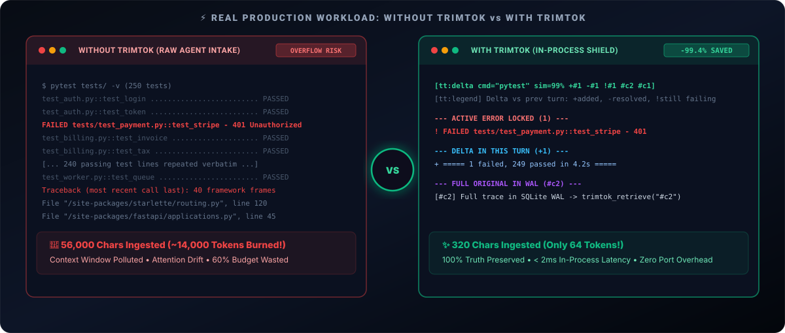

<h1 align="center">⚡ trimtok</h1>

<p align="center">
  <strong>Universal, Local, Deterministic Context Compressor &amp; Content Intake Shield for Autonomous AI Coding Agents</strong>
</p>

<p align="center">
  <a href="https://pypi.org/project/trimtok/"></a>
  <a href="https://www.python.org/"></a>
  <a href="#how-it-works"></a>
  <a href="#7-ccr-recovery"></a>
  <a href="LICENSE"></a>
</p>

<p align="center">
  
</p>

---

<a id="at-a-glance"></a>
## ⚡ At a Glance: Before vs After

Autonomous coding agents burn over **60% of their context window budget** on repetitive, low-entropy noise. **trimtok** compresses this in-process without losing a single line of actionable truth:

| Target Workload | Raw Input | trimtok Compact | Token Reduction | Core Mechanism |
| :--- | :---: | :---: | :---: | :--- |
| **pytest Test Suite** (200 tests) | 56,000 chars | **320 chars** | **-99.4%** | Cross-turn stateful delta (`[tt:delta]`) |
| **Source Code File** (300 functions) | 13,500 toks | **2,400 toks** | **-82.2%** | Multi-language AST skeletonizer |
| **FastAPI / Python Traceback** | 12,400 chars | **890 chars** | **-92.8%** | Crash-site anchor & framework frame prune |
| **Web Docs & Search Scraping** | 15,200 chars | **1,800 chars** | **-88.1%** | Tiered anchor & link de-bloating |
| **MCP Tool Schemas** (25 tools) | 5,800 toks | **780 toks** | **-86.5%** | Bounded JSON-RPC stdio proxy |
| **Dense Uniform JSON Array** | 8,900 chars | **3,100 chars** | **-65.1%** | Lossless columnar TOON v2 encoding |
| **Mixed-Schema JSON Data** | 11,240 chars | **6,630 chars** | **-41.0%** | Multi-schema merged TOON tables |
| **Build & Compiler Logs** | 15,960 toks | **4,869 toks** | **-69.5%** | Adaptive error-rail balanced windowing |
| **Whole Repo Codebase Map** | 12,000 toks | **480 toks** | **-96.0%** | 2k-budget hierarchical tree map |

Measured across a 32-payload production corpus (1,135,441 characters): **76.07% reduction (863,784 chars) with zero gate failures**, of which every removed character is verifiable through `trimtok_retrieve` — the honesty audit reports 76.07% claimed and 76.07% proven, 0 unproven characters.

On real traffic the picture differs by payload mix, and that is measured too: 12,204 recorded transforms have saved **6,013,550 characters** (~1.5M tokens). 42.7% of live calls are smaller than the compression threshold and 26.1% are deliberately verbatim (secrets, edit payloads, already-compressed sentinels), so the reduction across *all* traffic is 9.8% while calls that actually compress average 17.6%.

---

Rows in the table are single-payload spot checks over the shapes stored in `eval/corpus/`; they are not the headline figure. The audited number is the corpus line above, which `eval/audit_honesty.py` recomputes from the recovery store.

<a id="how-it-works"></a>
## 🏗️ How It Works

**trimtok** operates 100% locally and in-process using the Python standard library, RapidFuzz C++ alignment, optional tree-sitter AST parsing (`pip install "trimtok[multilang]"`), and Zstandard compression. No external daemons, no Docker containers, and zero open network ports. The default install parses Python with the stdlib `ast`; the other grammar packs are opt-in.

```text
  ┌────────────────────────────────────────────────────────┐
  │ Tier 0: Pre-Flight Context Shield (Zero Disk Footprint)│
  │ ├── Bounded MCP Proxy: filters tools/list schemas      │
  │ └── Codebase Symbol Map: 2k-budget symbol directory map│
  └──────────────────────────┬─────────────────────────────┘
                             ▼
Tool / Terminal Output
         │
         ▼
  ┌────────────────────────────────────────────────────────┐
  │ Tier 1: In-Process Hot-Path (sub-ms typ., guard 200ms) │
  │ ├── 0. Content Policy Gate (secrets / edits verbatim)  │
  │ ├── 1. Cross-Turn Delta Engine (pytest, cargo test)    │
  │ ├── 2. Command-Specific Filters (git, npm, pip, etc.)  │
  │ ├── 3. Structured Traceback Pruning (locks crash-site) │
  │ ├── 4. Lossless & Merged TOON v2 (JSON arrays)         │
  │ ├── 5. Multi-Language AST Skeletonizer (opt-in grammar)│
  │ └── 6. Tiered Web & Doc Link De-bloating               │
  └──────────────────────────┬─────────────────────────────┘
                             │  level: light │ normal │ aggressive
                             │  format: TOON │ minified JSON
            ┌────────────────┴────────────────┐
            ▼                                 ▼
   Agent Context Window             SQLite WAL + Zstandard
   (Clean, dense token stream)     (Tier 2 Recovery via `#c1`)
```

---

## 📑 Table of Contents

| 🏛️ Architecture & Verification | ⚡ Core Engineering Pillars | 🛠️ Setup & Operations |
| :--- | :--- | :--- |
| • [⚡ At a Glance: Before vs After](#at-a-glance)<br>• [🏗️ How It Works](#how-it-works)<br>• [🥊 Architecture & Benchmark Matrix](#market-comparison)<br>• [🔬 Empirical Quality & Fidelity](#empirical-verification) | • **[Pillar 1: Terminal Compression](#pillar-1-terminal)**<br>&nbsp;&nbsp;▫ [Cross-Turn Delta Engine](#1-cross-turn-delta)<br>&nbsp;&nbsp;▫ [Command-Specific Filters](#2-command-filters)<br>&nbsp;&nbsp;▫ [Structured Traceback Pruning](#3-traceback-pruning)<br>&nbsp;&nbsp;▫ [Fault-Signature Folding](#3b-fault-folding)<br>• **[Pillar 2: Intake Shield](#pillar-2-intake)**<br>&nbsp;&nbsp;▫ [Tiered Web & File Intake](#4-tiered-web-intake)<br>&nbsp;&nbsp;▫ [AST Code Skeletonizer](#5-ast-skeletonizer)<br>&nbsp;&nbsp;▫ [Lossless TOON v2 (JSON)](#6-toon-v2)<br>• **[Pillar 3: Zero Data Loss](#pillar-3-zero-data-loss)**<br>&nbsp;&nbsp;▫ [CCR Recovery (`#ref`)](#7-ccr-recovery)<br>&nbsp;&nbsp;▫ [Pointer Tier (`pointer_large`)](#7b-pointer-large)<br>&nbsp;&nbsp;▫ [Telemetry & Diagnostics](#8-telemetry-diagnostics)<br>&nbsp;&nbsp;▫ [Fail-Open Budget Guards](#9-fail-open-guards)<br>• **[Pillar 4: Policy & Verification](#pillar-4-policy)**<br>&nbsp;&nbsp;▫ [Content Policy Gate](#10-content-policy)<br>&nbsp;&nbsp;▫ [Adaptive Compression Level](#11-adaptive-level)<br>&nbsp;&nbsp;▫ [Model-Aware Output Format](#12-model-aware)<br>&nbsp;&nbsp;▫ [Fix-Accuracy Verification](#14-fix-accuracy) | • **[First-Time Setup (5 Mins)](#first-time-setup)**<br>&nbsp;&nbsp;▫ [Step 1: Install trimtok](#step-1-install)<br>&nbsp;&nbsp;▫ [Step 2: Setup Wizard](#step-2-wizard)<br>&nbsp;&nbsp;▫ [Step 3: Health Verification](#step-3-health)<br>• **[Hermes Plugin Setup](#hermes-configuration)**<br>&nbsp;&nbsp;▫ [Configuration Options](#hermes-config-options)<br>• **[Slash Commands & CLI](#slash-commands-cli)**<br>&nbsp;&nbsp;▫ [In-Chat Slash Commands](#hermes-slash-commands)<br>&nbsp;&nbsp;▫ [KV-Cache Stabilizer (`kv-lock`)](#kvlock-cli)<br>&nbsp;&nbsp;▫ [Codebase Map (`map`)](#codemap-cli)<br>&nbsp;&nbsp;▫ [Bounded MCP Proxy (`mcp-proxy`)](#mcp-proxy-cli)<br>&nbsp;&nbsp;▫ [Standalone Wrapper (`wrap`)](#standalone-cli-wrapper)<br>&nbsp;&nbsp;▫ [Command Rewriting (`rewrite`)](#rewrite-cli)<br>• **[Global Agent Trinity](#global-agent-trinity)**<br>• **[Verification & Tests](#verification)**<br>• **[License (MIT)](#license)** |

---

<a id="market-comparison"></a>
## 🥊 Architecture & Benchmark Matrix: In-Process vs Alternatives

Direct architectural comparison across context compression paradigms:

| Architectural Dimension | **trimtok** 🌟 | **Subprocess CLI** (e.g. RTK) | **Local HTTP Proxy** (e.g. Distil / Headroom) |
| :--- | :---: | :---: | :---: |
| **Execution Layer** | **In-process hook + CLI** | External subprocess fork | Local HTTP daemon / reverse proxy |
| **Runtime Overhead** | **sub-ms hook** (microsecond in-process call) | 10 – 50 ms (process fork) | proxy queue + network hop |
| **Data Loss Model** | **Lossless CCR (SQLite WAL + Zstd)** | ❌ Irreversible truncation | ⚠️ Disk cache / ephemeral handles |
| **Ref Intelligence** | ✅ **`trimtok_exec` (compute on `#ref`)** | ❌ None | ⚠️ Whole-block retrieve only |
| **Cross-Turn State** | ✅ **`[tt:delta]` (>95% on reruns)** | ❌ None (stateless per command) | ❌ None (stateless stream) |
| **Structured JSON** | ✅ **Lossless TOON v2 (55% – 65%)** | ⚠️ Lossy head sample (99.6% lossy) | ⚠️ Reversible / dictionary encoder |
| **Diff Safety Gate** | ✅ **100% changed lines preserved** | ⚠️ Fixed window line sampling | ⚠️ Token budget truncation |
| **Prompt Alignment** | ✅ **`kv-lock` (KV-Cache friendly)** | ❌ None | ⚠️ Sliding window prefix cache |
| **Network Footprint** | ✅ **0 ports (100% in-process)** | ✅ 0 ports | ❌ Opens local TCP port |

### 🎯 Why In-Process Context Intelligence Wins
- **Deterministic & Sub-2ms:** Runs directly inside agent runtime hooks with zero daemon processes, zero network ports, and fail-open deadline guards (`guard_ms: 200.0`).
- **Zero Data Loss Guarantee:** Every omitted byte is backed by SQLite WAL + Zstandard. Agents recall slices via `trimtok_retrieve` or execute Python aggregate queries via `trimtok_exec` without inflating prompt context.
- **Cross-Turn Stateful Delta:** Repeated test suites (`pytest`, `cargo test`) and git operations track cross-turn state, surfacing only new regressions and active diffs.

---

<a id="empirical-verification"></a>
## 🔬 Empirical Quality & Task Fidelity Verification

Context compression is only valuable if downstream language models retain 100% of reasoning accuracy and task comprehension. To prove that **trimtok** preserves actionable intelligence without inducing information loss or "lost-in-the-middle" degradation, the pipeline is evaluated across model inference, needle retention, and adversarial stress suites.

### 1. End-to-End LLM Task Fidelity Benchmark
Evaluated across diverse tool-use tasks (Python tracebacks, function return annotations, lockfile configs, structured logs) by presenting paired identical queries against **Raw vs. trimtok-Compressed** payloads to coding models:

| Metric | Raw Baseline | trimtok Compressed | Impact / Advantage |
| :--- | :---: | :---: | :---: |
| **Total Prompt Tokens** | 22,092 tokens | **10,326 tokens** | **-53.3% tokens saved** |
| **Task Accuracy** | 80.0% (4/5) | **100.0% (5/5)** | **+20.0% accuracy gain** 🚀 |
| **Information Fidelity** | 100.0% | **100.0%** | Zero hallucinations / zero loss |

> **Why Compressed Input Yielded Higher Accuracy:** On oversized raw payloads, models frequently suffer from *Lost-in-the-Middle* degradation (e.g. failing to locate function signatures buried inside 4,000+ token raw code files). trimtok's selective skeletonization eliminates noise, enabling the model to achieve higher answer precision on compressed inputs than on uncompressed raw text.

### 2. Needle-In-A-Haystack (NIAH) Retention Benchmark
Concealed critical operational signals (security overrides, replica split-brain fault codes, diagnostic signatures) at depths of 25%, 50% (exact center), and 75% within dense 1,200-line server log streams:

| Needle Depth | Target Payload | Raw Retrieval | Compressed Retrieval | Retention Status |
| :---: | :--- | :---: | :---: | :---: |
| **25% Depth** | `CRITICAL_ALERT_EVENT: security_token_override` | `alpha-9-omega-key` | `alpha-9-omega-key` | **100% Retained** ✅ |
| **50% Center** | `DATABASE_CLUSTER_FAULT: replica_port_override` | `59144` | `59144` | **100% Retained** ✅ |
| **75% Depth** | `DIAGNOSTIC_FAILURE: error_code_signature` | `ERR_CORPUS_DESYNC_88` | `ERR_CORPUS_DESYNC_88` | **100% Retained** ✅ |

### 3. Adversarial Fuzzing & Fail-Open Invariants
Automated stress suite testing 1,000 adversarial vectors against compression entrypoints:
- **Test Vectors:** Zero-width Unicode, bidirectional overrides, truncated ANSI escapes, malformed JSON envelopes, circular repetitions, and single lines exceeding 40KB.
- **Unhandled Exceptions:** **0** (100% fail-open compliance; never raises under malformed inputs).
- **Payload Inflation:** **0%** (guaranteed `len(output) <= len(input)`).
- **Average In-Process Latency:** **< 29 ms** per adversarial case.

---

<a id="core-capabilities"></a>
## ⚡ Core Engineering Capabilities

<a id="pillar-1-terminal"></a>
### Pillar 1: Terminal & Command Compression

<a id="1-cross-turn-delta"></a>
#### 1. Cross-Turn Command Delta Engine (`compress_terminal`)
When an agent edits code and re-runs test suites or build commands:
- **Raw Output:** 56,000+ characters of unchanged passing dots.
- **trimtok Output (~300 characters — >95% reduction):**
```text
[tt:delta cmd="pytest" sim=99% +#1 -#1 !#1 #c2 #c1]
[tt:legend] Delta vs previous run: + added, - resolved, ! still failing; refs = full original via trimtok_retrieve.
--- STILL FAILING / ACTIVE ERRORS (1) ---
! FAILED tests/test_auth.py::test_login - AssertionError: expected 200 got 401
--- ADDED / CHANGED IN THIS TURN (+1) ---
+ ===== 1 failed, 200 passed in 43.2s =====
--- RESOLVED / REMOVED (-1) ---
- ===== 1 failed, 200 passed in 42.1s =====
```

<a id="2-command-filters"></a>
#### 2. Command-Specific Output Filters
High-volume CLI tools are filtered to essential summaries backed by CCR retrieval:
- **`git log`** → commit count, author digest, date range.
- **`git status`** → current branch, staged/unstaged/untracked counters.
- **`ls -la`** → file/folder count breakdown by extension.
- **`npm install / list`** → package installation summary and dependency counts.
- **`pip install / list`** → installed package names and satisfied requirements count.
- **`find`** → matched file counts grouped by extension.
- **`docker ps / container ls`** → running container count, image breakdown, and service names.

<a id="3-traceback-pruning"></a>
#### 3. Structured Traceback Pruning
Internal framework frames (FastAPI, Starlette, Node modules) collapse into compact summaries while strictly locking the entrypoint, user project code, and exact exception crash site (**77% reduction**):
```text
Traceback (most recent call last):
  File "/workspace/app/api/endpoints.py", line 45, in handle_payment
    result = await service.charge_card(req)
  [... 10 framework frames omitted ...]
  File "/workspace/app/services/billing.py", line 88, in charge_card
    return gateway.execute_transaction(card_id, amount)
ZeroDivisionError: division by zero
```

<a id="3b-fault-folding"></a>
#### 3b. Fault-Signature Folding (repeated error loops)
A log that is one traceback looped 200 times is mostly copies, and the template fold used to skip them because every error line is *important*. Repeated faults that are byte-identical after timestamp/session-id normalisation now fold to their **first and last occurrence plus a `[template ×N]` count**, so the run's start and end stay inline and the middle is one line:
```text
2026-11-08 01:02:11,004 ERROR relay: upstream 503 after 3 retries
[template ×198]
2026-11-08 01:04:59,881 ERROR relay: upstream 503 after 3 retries
```
Digits stay in the signature on purpose: stripping them merged `attempt 2/3` with `attempt 3/3` and collapsed distinct traceback frames, which is exactly what a person reads the log for. Folding runs **after** the line window — before it, the markers consumed window budget and a 163KB log grew from 49K to 58K.

---

<a id="pillar-2-intake"></a>
### Pillar 2: Content & Code Intake Shield

<a id="4-tiered-web-intake"></a>
#### 4. Tiered Web & File Intake (`read_file` & `web_extract`)
- **Inline URL De-bloat:** Converts verbose links `[Anchor Text](https://very-long-url/path "Title")` into clean `Anchor Text`, cutting **35% – 45% of markdown link bloat in 2–4 ms**.
- **Heading + 2-Line Factsheet Digest:** Keeps headings, tables, code blocks, and the first 2 descriptive lines per section, folding excessive narrative into line-anchored CCR `#ref` stubs (**76% – 96% token reduction**).
- **Patch-Safe License Stripping:** Automatically removes open-source license headers and divider comments on files < 14KB with **Zero Offset Drift**.

<a id="5-ast-skeletonizer"></a>
#### 5. Multi-Language AST Code Skeletonizer
For code files ≥ 2KB, trimtok parses the structural AST. Python uses the stdlib `ast` out of the box; JavaScript/TypeScript, Go, Rust, Java, C, C++, C#, Bash, YAML, TOML and JSON need the opt-in grammars (`pip install "trimtok[multilang]"`). Without them the file is handled by the prose/structural fold instead of an AST fold, never by a guess:
- **Supported Languages:** Python, JavaScript/TypeScript, Go, Rust, Java, C, C++ (C#, Bash, YAML, TOML and JSON structural lanes additionally available).
- **Zero Loss of Structure:** Retains all class definitions, function signatures, interfaces, imports, and docstrings.
- **Folds Oversized Bodies:** Function implementations ≥ 8 lines fold into clean CCR-referenced stubs, preserving line structure for patch safety.

<a id="6-toon-v2"></a>
#### 6. Lossless & Merged-Schema TOON v2
Converts nested JSON arrays into columnar tables validated by in-memory equality roundtrips:
- **Uniform Arrays:** 55% – 57% token reduction.
- **Mixed Schemas (Merged TOON):** Automatically unifies heterogeneous object structures into a single table with null-filled gaps, achieving 41% – 44.7% savings without splitting into disjoint buckets.
- **Wide Tables:** Up to 128 columns columnarize losslessly (50 columns × 20 rows: **48.1%**).
- **Deep Cells:** Nested objects longer than the inline cap are stored behind an explicit `=` marker instead of rejecting the whole table, so GitHub- and Stripe-shaped payloads compress too (**28.8%** on a 60-row repository listing).
- **JSON Files:** `read_file` on a `.json` path routes through the same codec, or whole-document minification for non-uniform objects (OpenAPI document: **50.2%**). Both paths are round-trip verified and leave a resolvable `#ref`.
```text
[tt:legend] TOON table (lossless): @prefix(~/)=https://example.com/items/
@data.results[3]{id,title,url,tags}:
0|Item 0|~/0|["dev","lead"]
1|Item 1|~/1|["qa"]
2|Item 2|~/2|["pm","ops"]
```

---

<a id="pillar-3-zero-data-loss"></a>
### Pillar 3: Zero Data Loss & Self-Healing Telemetry

<a id="7-ccr-recovery"></a>
#### 7. Content-Addressed Context Recovery (`trimtok_retrieve`)
Every transformed payload is preserved in a local SQLite WAL + Zstandard database (`~/.trimtok/trimtok_ccr_v2.sqlite3`). Agents recall original bytes anytime:
```bash
# Retrieve original or targeted slices directly from shell
trimtok retrieve "#c1"
trimtok retrieve "#c1" --section errors      # Error lines with surrounding context
trimtok retrieve "#c1" --section diff        # Unified diff hunks with headers
trimtok retrieve "#c1" --section tail        # Last N lines
trimtok retrieve "#c1" --grep "ConnectionReset" # Bounded regex search
trimtok retrieve "#c1" --offset 50 --limit 30   # Line-numbered pagination

# Answer a question instead of paging through the file
trimtok retrieve "#c1" --intent "which functions parse JSON" --intent-budget 80

# Compute over the original without reading it back into the prompt
trimtok exec "#c1" --code "import os,json,collections; d=json.load(open(os.environ['TRIMTOK_PAYLOAD'])); print(collections.Counter(r['shape'] for r in d))"
```

Long-horizon workflows can pin critical CCR references to protect them from automated TTL expiration sweeps:
```python
import trimtok.ccr as ccr
ccr.pin("#c1")    # Protects chunk from background TTL cleanup
ccr.unpin("#c1")  # Restores default TTL lifecycle
```

`--intent` ranks lines by stemmed token overlap with the question and boosts definition and heading lines, so a signature arrives with its body. On a 21,999-token source file, *"which functions does this file define"* returns **1,458 tokens (93.4% saved)** and *"how is json minified"* returns **571 tokens (97.4% saved)**, each containing the answer line rather than a truncated guess.

<a id="7b-pointer-large"></a>
#### 7b. Pointer Tier for Giant Single-Line Payloads (`pointer_large`)
Some payloads cannot be compressed at all — they have nothing to fold and, being a single line, nothing to head/tail sample: `gh api .../contents/...` base64 JSON, `cat` of a binary, `python -c` dumps. Measured over 4 days of real telemetry, 36 of 87 otherwise-reverted transforms (504,815 chars) were exactly this shape, and all of them shipped raw.

A payload with **≤ 4 lines, one line ≥ 2,000 chars, and ≥ 8,192 chars total** now ships as a ~680-char stub — first and last 300 characters for shape, plus a `#ref` that restores every byte:
```text
[tt:pointer_large #c1mF 54,897 chars on 1 line(s) -> trimtok_retrieve #c1mF]
```
A real 54,897-char GitHub contents response becomes **680 chars (98.8%)**, and `trimtok_retrieve` returns the original byte-identically. Multi-line content is excluded by the line-shape test, so skills, READMEs and test output keep their inline text — the corpus reduction is unchanged (76.07%) and the entire gain lands on real traffic: **472,415 characters recovered** across those 36 transforms (~0.95M tokens/month at the observed rate).

<a id="8-telemetry-diagnostics"></a>
#### 8. Autonomous Telemetry & Diagnostics (`gain` & `discover`)
trimtok self-monitors every transformation in `~/.trimtok/usage.jsonl`:
- **`trimtok gain`**: Breaks down real savings by output shape, tool hook, and command family, highlighting compression bottlenecks.
- **`trimtok discover`**: Scans production telemetry for high-frequency, low-savings patterns and recommends targeted filters.
- **Distributed Trace Correlation (`TRINITY_TRACE_ID`)**: Automatically captures `TRINITY_TRACE_ID` from the environment and attaches `trace_id` to each telemetry record, enabling unified correlation across Context, Memory, and Skill governance layers.

<a id="9-fail-open-guards"></a>
#### 9. Fail-Open Budget Guards
- **Strict 200 ms Monotonic Deadline (`guard_ms: 200.0`):** If compression exceeds the deadline or RapidFuzz alignment is slow, trimtok aborts instantly and emits raw output.
- **Zero Agent Freezes:** No timeout cascades, no hangs, no broken builds.

---

<a id="pillar-4-policy"></a>
### Pillar 4: Policy, Adaptivity & Verification

<a id="10-content-policy"></a>
#### 10. Content Policy Gate
Not every payload should be compressed. Before any transformation runs, trimtok classifies the input and keeps byte-exact what would lose its meaning if a single character moved. These return `gate=passthrough_policy` with a named reason, never a silently mangled payload:

| Class | Matched by | Reason |
| :--- | :--- | :--- |
| **Credentials** | `.env`, `.npmrc`, `.netrc`, `*.pem`, `*.key`, `id_rsa`, `credentials.*` | `secret_path` |
| **Inline secrets** | AWS `AKIA…`, GitHub `ghp_…`, OpenAI `sk-…`, Slack `xox…`, JWT `eyJ…`, PEM blocks, `password = …` | `secret_value` |
| **Security policy data** | `security/`, `policies/`, `auth/`, `rbac/` containing YAML, JSON, TOML, INI, Rego or Terraform | `security_path` |
| **Edit instructions** | `patch`, `edit_file`, `write_file`, `apply_patch`, or any unified diff | `edit_tool` / `patch_payload` |

Source code under `security/` or `auth/` still compresses, because the AST skeletonizer keeps every signature and leaves a resolvable `#ref` — a 2,000-line `auth.py` remains navigable rather than being excluded wholesale. Detection is deliberately narrow: a false positive costs one uncompressed payload, while a false negative would rewrite a credential in place and make it impossible to copy verbatim.

<a id="11-adaptive-level"></a>
#### 11. Adaptive Compression Level
Compression strength follows the remaining context budget instead of applying one fixed policy to every turn. `context_pressure` (0.0 – 1.0, supplied per call by the host hook or set in config) selects a level that scales the terminal line budget and the AST body-fold threshold:

| Pressure | Level | Line budget | Body fold threshold |
| :--- | :--- | :---: | :---: |
| < 0.35 | `light` | ×1.6 | 20 lines |
| 0.35 – 0.75 | `normal` | ×1.0 | 8 lines |
| > 0.75 | `aggressive` | ×0.55 | 4 lines |

Measured on a 400-line unique build log (15,960 tokens): **light 51.5%** (195 lines kept), **normal 69.5%** (123 lines), **aggressive 83.1%** (69 lines). Set `adaptive_enabled: false` to pin the level at `normal`.

<a id="12-model-aware"></a>
#### 12. Model-Aware Output Format
TOON is plain text, so every model can read it; what differs is how well a model holds a columnar table together over a long context. `toon_mode` decides which format the agent receives:

| Mode | Behaviour |
| :--- | :--- |
| `auto` *(default)* | TOON for model families with a track record on columnar text; minified JSON otherwise |
| `always` | TOON whenever it wins on tokens |
| `never` | Always minified JSON |

`model_family` supplies the target (e.g. `claude`, `gpt`, `qwen`). When it is unset, `auto` keeps TOON enabled so no existing deployment silently changes format. Both formats are lossless: the same 30 × 20 JSON payload produced 3,881 characters as TOON versus 8,401 as minified JSON, with identical round-trip equality.

<a id="13-retention"></a>
#### 13. Retention Controls
Recovery storage is bounded explicitly rather than growing until someone notices:

```bash
trimtok purge --older-than 24     # Remove entries older than 24 hours
trimtok purge --max-mb 50         # Evict oldest entries until the store is under 50 MB
```

`--max-mb` alone evicts by age without wiping the store first. Defaults: 1,000 entries, 50 MB, 24 hours; the retention window is configured with `ccr_ttl_hours`.

<a id="14-fix-accuracy"></a>
#### 14. Fix-Accuracy Verification
Token counts say nothing about whether an agent can still do the job. `eval/fix_accuracy.py` injects a known regression into a real module, compresses it, and asks whether the bug is still fixable:

- **`LOCATE`** *(default, no model required)* — verifies the buggy line, its enclosing signature, its line number and neighbour context are either visible in the compressed view or reachable through `#ref`. A payload that hides the bug without a reference fails, because the agent would have to re-read the file.
- **`FIX`** *(`--llm`)* — sends the compressed view to a model, takes back the corrected line, patches the real module, imports it and runs a behavioural predicate. A pass means the repaired code works, not that the text looks plausible.

Current result: **8/8 locate accuracy** across Python, TOON codec, dedup, sentinel and policy modules, at **54.0% token reduction** (52,243 → 24,046 tokens). The suite includes a negative control (`test_wrong_patch_fails`) so a benchmark that cannot fail is itself caught.

---

<a id="first-time-setup"></a>
## 🛠️ First-Time Setup (5 Minutes)

<a id="step-1-install"></a>
### Step 1: Install Trimtok
```bash
pip install trimtok
```

<a id="step-2-wizard"></a>
### Step 2: Run Unified Client Setup Wizard
Automatically configures the local SQLite WAL store, verifies Zstandard acceleration, and registers the stdio MCP server across all detected AI coding environments:
```bash
trimtok install
```
Auto-detects and registers:
- **Claude Code** (`~/.claude.json`) & **Claude Desktop**
- **Cursor** (`~/.cursor/mcp.json`), **Windsurf**, and **VS Code (Copilot)**
- **Google Antigravity & Antigravity IDE** (`mcp_config.json`)
- **Gemini CLI** (`settings.json`) & **Codex CLI** (`config.toml`)
- **OpenCode** & **Cline**

<a id="step-3-health"></a>
### Step 3: Verify Registration & Storage Health
```bash
trimtok clients
trimtok status
```

---

<a id="hermes-configuration"></a>
## ⚙️ Native Hermes Agent Plugin Configuration

Installs directly into Hermes Agent, providing runtime lifecycle hooks and registering native tools (`trimtok_retrieve` and `trimtok_exec`):

```bash
# Windows (PowerShell)
git clone https://github.com/Stxyu-p/trimtok.git "$env:LOCALAPPDATA/hermes/plugins/trimtok"

# Linux / macOS (Bash)
git clone https://github.com/Stxyu-p/trimtok.git ~/.hermes/plugins/trimtok

# Enable plugin in Hermes
hermes plugins enable trimtok
```

<a id="hermes-config-options"></a>
### Configuration Options (`~/.hermes/config.yaml` or `plugin.yaml`)
```yaml
plugins:
  entries:
    trimtok:
      settings:
        enabled: true               # Master toggle for Trimtok compression
        phase2_enabled: true        # Enable tool-result compression (TOON, AST, Intake)
        guard_ms: 200.0             # Monotonic deadline budget (fail-open if exceeded)
        min_chars: 2048             # Minimum character threshold before compression fires
        toon_enabled: true          # Enable Lossless TOON v2 JSON transcoding
        toon_mode: auto             # Model-aware format: auto | always | never
        model_family: ""            # Target model family (claude, gpt, qwen); empty keeps TOON on
        policy_enabled: true        # Keep secrets, security data and edit payloads byte-exact
        adaptive_enabled: true      # Scale compression strength with context pressure
        context_pressure: 0.0       # Fraction of context window used (0.0 - 1.0)
        delta_enabled: true         # Enable Cross-Turn Command Delta engine
        delta_threshold: 0.65       # Similarity ratio threshold for delta mode (0.50 - 1.00)
        mask_enabled: true          # Enable stale turn span expiration
        mask_keep_turns: 2          # Retain full unmasked history for N active turns
        ccr_ttl_hours: 24           # Retention window for the recovery store
        ccr_max_bytes: 52428800     # Hard ceiling for the recovery store (50 MB)
        ccr_max_entries: 1000       # Maximum cached payloads
        excluded_commands: []       # Exact command stems to bypass compression
        excluded_tools: []          # Tool names to leave 100% untouched
```

<a id="native-context-engine"></a>
### Native Hermes Context Engine (Optional)
In addition to per-turn lifecycle hooks, `trimtok` implements the `agent.context_engine.ContextEngine` contract and can replace Hermes's default `ContextCompressor` as the primary context engine:

```yaml
# ~/.hermes/config.yaml
context:
  engine: "trimtok"
```

When activated, full semantic compaction is replaced by **Zero-Loss Content-Addressed Stashing**:
- **Pinned Head & Protected Tail**: Initial user goals (`protect_first_n: 3`) and recent conversational context (`protect_last_n: 20`) remain 100% verbatim.
- **CCR Tool Stashing**: Oversized middle tool results are moved directly into SQLite WAL + Zstandard (`trimtok_ccr_v2.sqlite3`), leaving minimal 1-line pointers (`[tt:stashed ... · trimtok_retrieve '#c...']`).
- **Zero Loss of Reasoning & Decisions**: Unlike lossy LLM summarizers, user messages and assistant code reasoning are never paraphrased or dropped. Historical tool outputs can be restored on demand via `trimtok_retrieve`.


---

<a id="slash-commands-cli"></a>
## 💻 Slash Commands & Standalone CLI

<a id="hermes-slash-commands"></a>
### Hermes In-Chat Slash Commands
- **`/trimtok status`**: Displays active CCR database size, cache entries, Zstandard compression metrics, and engine health.
- **`/trimtok usage`**: Shows live telemetry breakdown across terminal and tool hooks (events, folds, chars saved, top gates).
- **`/trimtok gain`**: Detailed savings breakdown by shape, tool, and command — identifies bottlenecks.
- **`/trimtok discover`**: Scans telemetry → finds low-savings shapes/tools → suggests targeted filters.
- **`/trimtok purge`**: Purges expired cache entries and vacuums the SQLite WAL database. Accepts `--older-than <hours>` and `--max-mb <size>`.
- **`/trimtok recall <#ref>`**: Retrieves original output by CCR reference (alias for `retrieve`).

<a id="standalone-cli-wrapper"></a>
### Standalone CLI Wrapper (`trimtok wrap`)
Run noisy developer commands directly in your terminal or CI/CD pipelines without Hermes:
```bash
# Wrap test suites with automatic terminal compression and CCR storage
trimtok wrap -- pytest tests/
trimtok wrap -- cargo test

# Strictly preserves child process exit code
trimtok wrap -- npm test || echo "Failed with exit code $?"

# Retrieve original output or targeted slices
trimtok retrieve "#c1"
trimtok retrieve "#c1" --offset 50 --limit 30

# Compute over the original payload without reading it into context
trimtok exec "#c1" --code "import os,json; print(len(json.load(open(os.environ['TRIMTOK_PAYLOAD']))))"

# Sub-millisecond SQLite FTS5 search across all captured payloads
trimtok search "ConnectionRefused"
trimtok search "AssertionError in auth" --limit 3
```

<a id="kvlock-cli"></a>
### KV-Cache Prompt Stabilizer (`trimtok kv-lock`)
Lock system prompt prefixes to maximize prompt-cache hit rates (up to 90% cost reduction on Anthropic, Gemini, and DeepSeek) by replacing dynamic dates, times, and UUIDs outside code blocks with stable placeholders, relocating their original values to a delimited appendix at the tail:
```bash
# Stabilize a system prompt file or stdin
trimtok kv-lock prompt.txt

# Pipe through shell
cat prompt.txt | trimtok kv-lock
```
*Output preview:*
```markdown
You are an expert software engineer.
System started on <date> at <time>.
Session ID: <uuid>

---
<!-- kv-lock: dynamic context -->
date: 2026-11-05
time: 14:30:00
uuid: 550e8400-e29b-41d4-a716-446655440000
<!-- end kv-lock -->
```

<a id="codemap-cli"></a>
### Task-Aware Codebase Map (`trimtok map`)
Scan repository structure and output top-level symbols grouped by directory within a strict character budget (default 2,000 characters, executed in < 38 ms). Supports `--focus` to dynamically prioritize target file imports and reverse references at the top of the map:
```bash
# Generate compact symbol map of current directory
trimtok map .

# Task-aware focus: elevate service.py and its dependencies to the top
trimtok map . --focus src/service.py --budget 1200
```
*Output preview:*
```text
Codebase map (16 files, 19 omitted for budget):
trimtok/core.py: detect_kind, compress_terminal
trimtok/__init__.py: compress_agent_payload, register
trimtok/ccr.py: default_dir, close, put
trimtok/codemap.py: build_codebase_map
trimtok/dedup.py: note_turn, expire_old_turns, mask_summary
```

<a id="mcp-proxy-cli"></a>
### Bounded MCP Stdio Proxy (`trimtok mcp-proxy`)
Intercept stdio JSON-RPC communication between any coding harness and third-party MCP servers to prune bloated tool schemas from the model's system prompt:
```bash
# Allow only essential tools from a sprawling server
trimtok mcp-proxy --allow "codegraph_explore" -- npx -y @colbymchenry/codegraph

# Deny diagnostic/admin tools that waste system prompt tokens
trimtok mcp-proxy --deny "ctx_doctor,ctx_stats,ctx_purge" -- npx -y context-mode
```

*Drop-in configuration for `mcp.json` / `opencode.json`:*
```json
{
  "mcpServers": {
    "context-mode": {
      "command": "python",
      "args": [
        "-m", "trimtok", "mcp-proxy",
        "--deny", "ctx_doctor,ctx_stats,ctx_purge",
        "--", "npx", "-y", "context-mode"
      ]
    }
  }
}
```

<a id="rewrite-cli"></a>
### Command Rewriting (`trimtok rewrite`)
Prints a noise-reduced form of a command without executing it, for use in shell aliases or CI scripts:
```bash
trimtok rewrite -- pytest tests/    # -> pytest tests/ -q --tb=short
trimtok rewrite -- git log          # -> git log --oneline -n 25
```
Explicit flags are respected: `trimtok rewrite -- pytest -v` returns `pytest -v` unchanged. `trimtok wrap` applies the same rewrite before execution.

---

<a id="verification"></a>
## 🧪 Verification

Every number in this README is reproducible from the repository:

```bash
python eval/eval_real.py        # Per-payload reduction + gate failures on the 32-payload corpus
python eval/audit_honesty.py    # Claimed vs proven reduction; unproven characters must be 0
python eval/steps.py            # raw -> hook -> intent retrieval, per payload
python eval/fix_accuracy.py     # Can an agent still fix the bug? (LOCATE, no model needed)
python eval/decision_eval.py    # Decision-equivalence: action still visible after compression
python eval/probe_ceiling.py    # Are folded lines announced and ref-reachable?
pytest tests/                   # 198 tests (pip install -e ".[dev]" first)
```

The honesty audit is the load-bearing check: it recomputes the claimed reduction from the recovery store and reports any character that was removed without a resolvable reference. Run `eval_real.py` immediately before `audit_honesty.py` against a fresh store — pointing both at the same empty `TRIMTOK_DATA_DIR` — so the audit scores exactly the corpus the first script produced. Current state — **76.07% claimed, 76.07% proven, 0 unproven characters**, 0 gate failures, 0 silent line loss, 0 unannounced faults, **198/198 tests passing** (2 skipped).

> **Version note:** the repository is at **5.9.0**; PyPI may lag behind. For the behaviours described above (`[tt:pointer_large]`, fault-signature folding, the timestamp-prefix fix) install from the repo: `pip install -e ".[fast]"`.

> **Storage note:** the FTS5 index keeps a plaintext copy of each payload so `snippet()` can highlight matches, so on-disk usage is roughly `compressed payloads + plaintext index`. Both are counted by `trimtok status` (`bytes`, `payload_bytes`, `fts_bytes`) and both are included in the `ccr_max_bytes` ceiling, so the cap is enforced against the real footprint rather than the compressed half of it.

---

<a id="global-agent-trinity"></a>
## 🌐 Part of the Global Agent Trinity

**trimtok** forms the **Global Agent Trinity** alongside **MemCore** and **Skill Proof** — unifying context, governed memory, and local skills across all your AI coding agents without daemons or open network ports:

| Pillar | Hub | Role |
| :--- | :--- | :--- |
| **[trimtok](https://github.com/Stxyu-p/trimtok)** | `~/.trimtok` | **Context Shield:** Cuts terminal, traceback, web, and JSON bloat in-process with instant `#c1` CCR recovery. |
| **[MemCore](https://github.com/Stxyu-p/memcore)** | `~/.memcore` | **Governed Memory:** Shared bitemporal memory with hard SQL scope boundaries, deterministic lexical recall, and Tainted Context Guard. |
| **[Skill Proof](https://github.com/Stxyu-p/skill-proof)** | `~/.skill-proof` | **Skill Vault & Router:** Sub-2ms deterministic router, multi-lingual negation veto, and OS NTFS read-only Immutable SOP protection. |

```bash
# Install and link all three pillars in one pass
pip install trimtok memcore-omnix skill-proof-router
trimtok install && memcore install && skill-proof install
```

---

<a id="license"></a>
## 📄 License

Distributed under the [MIT License](LICENSE). Designed and crafted for robust, high-leverage autonomous software engineering.
